<p align="center">
  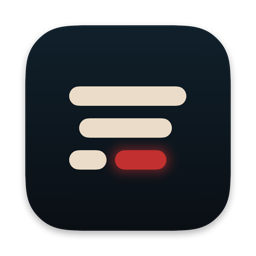
</p>

<h1 align="center">Stanza</h1>

<p align="center"><b>The song you are playing, sung word by word across your Mac's desktop and lock screen.</b></p>

<p align="center">
  <a href="https://github.com/Rayhanson-Git/stanza/releases/latest"></a>
  
  
  
  
  
  <a href="LICENSE"></a>
</p>

<p align="center">
  <a href="#install">Install</a> ·
  <a href="#features">Features</a> ·
  <a href="#the-23-styles">Styles</a> ·
  <a href="#read-deeper">Design and architecture</a> ·
  <a href="#using-stanza">Using Stanza</a> ·
  <a href="#privacy-and-network">Privacy</a> ·
  <a href="#build-from-source">Build</a> ·
  <a href="#releases">Releases</a> ·
  <a href="#licence">Licence</a>
</p>

<p align="center">
  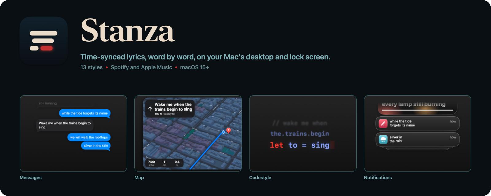
</p>

## Why Stanza

Stanza puts the words of the song you are playing where you already are: over the desktop and above the lock
screen, one word at a time, exactly as each is sung. It follows
the track playing in Spotify or Apple Music, finds lyrics timed to the song, and draws them in one of 23 styles, from
kinetic type that stretches on held notes to a split-flap departure board and a chat thread. Everything is designed
around one rule: the words come first. They stay readable over any wallpaper, land in time with the music, step back
in silence, and never ask for attention they have not earned. No accounts, no analytics, no telemetry.

<p align="center">
  
</p>

<table>
  <tr>
    <td width="50%">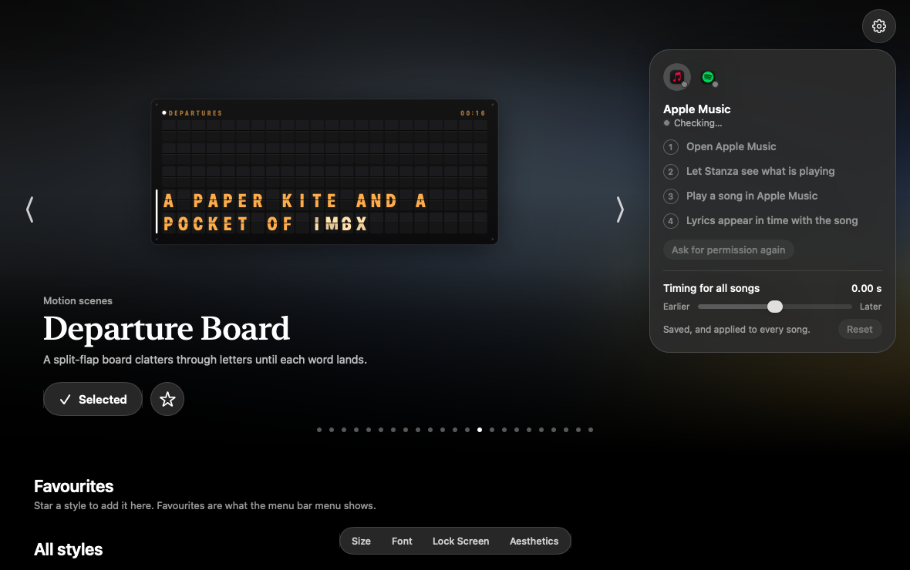</td>
    <td width="50%">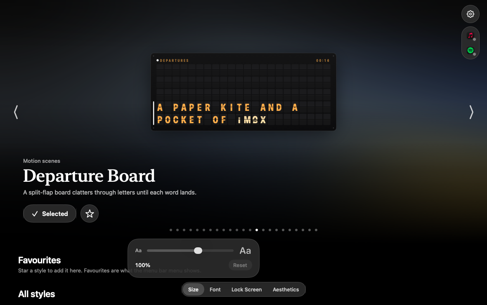</td>
  </tr>
  <tr>
    <td align="center"><sub><b>The player pill grows into its card.</b> Both icons slide into one row on top.</sub></td>
    <td align="center"><sub><b>A panel rolls up out of its button.</b> One at a time; Esc or a click away closes it.</sub></td>
  </tr>
</table>

<p align="center"><sub>The window, drawn offscreen by <code>Stanza --render-gallery</code>. Offscreen pictures show the glass as its flat fallback; on macOS 26 it is Liquid Glass.</sub></p>

## Features

<table>
  <tr>
    <td width="33%" valign="top"><b>Lyrics where you look</b><br>Above the lock screen, and over the desktop too if you like, on every display or only the ones you choose.</td>
    <td width="33%" valign="top"><b>Word by word</b><br>Each word appears as it is sung. Songs with only line timing get an estimated time for each word.</td>
    <td width="33%" valign="top"><b>23 styles, live</b><br>Every style plays in the window before you pick it, following your song or a built-in demo.</td>
  </tr>
  <tr>
    <td valign="top"><b>Favourites</b><br>Star the styles you like; they get their own row, and the menu-bar menu then lists only those.</td>
    <td valign="top"><b>Your look</b><br>Size from 25% to 150%, seven fonts, three colours of your own or colours from the album cover.</td>
    <td valign="top"><b>Put it anywhere</b><br>Drag Position: a slim glass pill to move and size the lyrics in one go, even past the edge of the screen.</td>
  </tr>
  <tr>
    <td valign="top"><b>Timing you can correct</b><br>Nudge one song a second at a time, or set a standing offset for every song.</td>
    <td valign="top"><b>Songs in English letters</b><br>Hindi, Urdu, Punjabi and Bengali songs show a version in English letters when one exists.</td>
    <td valign="top"><b>A guided setup</b><br>Each player shows what it still needs, as numbered steps, with a button for the next one.</td>
  </tr>
  <tr>
    <td valign="top"><b>Same size, any style</b><br>Every style was measured and balanced, so the same Size fills about the same part of the screen.</td>
    <td valign="top"><b>Calm</b><br>Lyrics step back in long gaps, fade 10 seconds into a pause, and honour Reduce Motion in the window and in 14 styles.</td>
    <td valign="top"><b>Quiet</b><br>No accounts, no analytics, no telemetry. It stops drawing whenever nothing can be seen.</td>
  </tr>
</table>

## Read deeper

Stanza is documented as a design project as much as an app: every look, every motion and every part of the code is
explained, with the reasoning and the numbers.

<table>
  <tr>
    <td width="33%" valign="top">
      <b><a href="docs/DESIGN.md">Design →</a></b><br>
      The principles (figure and ground, rhythm, continuity, progressive disclosure), the visual language, the motion
      system with every spring and timing, interaction design and accessibility.
    </td>
    <td width="33%" valign="top">
      <b><a href="docs/ARCHITECTURE.md">Architecture →</a></b><br>
      From the AppleScript poll to the lock-screen window: the song clock, the lyrics sources, the per-frame pipeline,
      the window and the update pipeline, with diagrams.
    </td>
    <td width="33%" valign="top">
      <b><a href="docs/STYLES.md">The 23 styles →</a></b><br>
      How each style plays, how it is built, why it looks that way, and the design theory behind its look and motion.
    </td>
  </tr>
  <tr>
    <td valign="top"><a href="docs/DESIGN.md">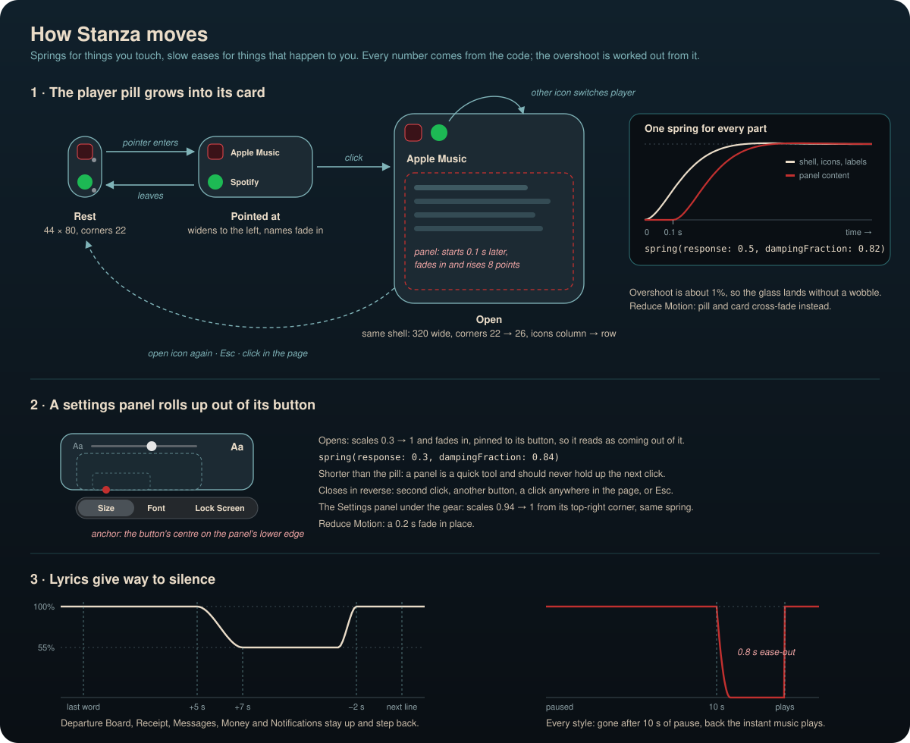</a></td>
    <td valign="top"><a href="docs/ARCHITECTURE.md">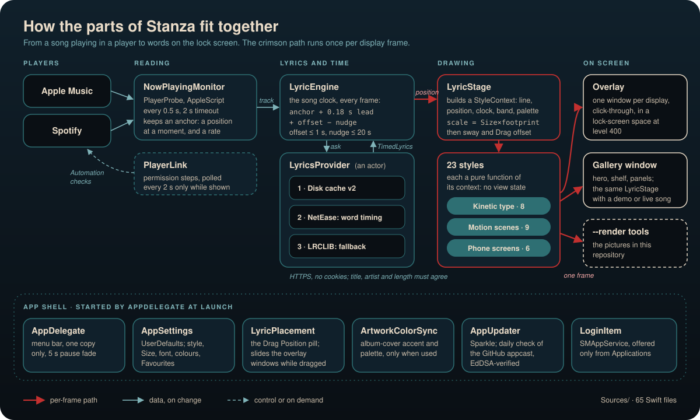</a></td>
    <td valign="top"><a href="docs/STYLES.md">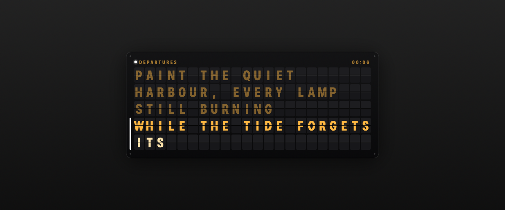</a></td>
  </tr>
</table>

## Install

1. Open the [latest release](https://github.com/Rayhanson-Git/stanza/releases/latest) and download
   **Stanza-&lt;version&gt;.dmg**.
2. Open the disk image and drag **Stanza** into **Applications**. Open it from Applications, not from the disk image.
3. The first time, macOS says it cannot check Stanza for malicious software, because Stanza is not notarised by Apple.
   Click **Done**, then open **System Settings → Privacy & Security**, scroll down and click **Open Anyway** next to
   Stanza.
4. Start a song in Spotify or Apple Music. When macOS asks whether Stanza may control the player, choose **Allow**.

You need a Mac with Apple silicon and macOS 15 or later.

**It keeps itself up to date.** Once a day Stanza looks for a new version, downloads it quietly and installs it the
next time Stanza restarts. While an update waits, the menu-bar menu and the window offer **Restart to Update**.
Choose **Check for Updates…** at any time, or switch off automatic installs under the gear at the top right of the
window. Updates are only installed when they carry this project's signature. What changed in each version is in
[CHANGELOG.md](CHANGELOG.md).

## The 23 styles

Each name links to its section in [docs/STYLES.md](docs/STYLES.md): how it plays, how it is built, and why.

| | Style | What it does |
|---|---|---|
| **Kinetic type** | [Ship](docs/STYLES.md#ship) | Every word settles onto a wall that sways slowly in space. |
| | [Fisheye](docs/STYLES.md#fisheye) | Three stacked words, swollen in the middle like a glass lens. |
| | [Visual](docs/STYLES.md#visual) | A centred column of words, with a small picture where one fits. |
| | [Fisheye Visual](docs/STYLES.md#fisheye-visual) | The lens stack, plus pictures next to the words that earn one. |
| | [Stretch](docs/STYLES.md#stretch) | Quick words snap in; held notes stretch wide, letter by letter. |
| | [Ransom Note](docs/STYLES.md#ransom-note) | Every word is a scrap cut from a different magazine and taped down. |
| | [Ink](docs/STYLES.md#ink) | Each word writes itself with a pen stroke, then the ink soaks in. |
| | [Liquid](docs/STYLES.md#liquid) | Words ooze out of one another and the line melts away at its end. |
| **Motion scenes** | [Codestyle](docs/STYLES.md#codestyle) | Lyrics typed out like source code behind a blinking red cursor. |
| | [Codestyle Visual](docs/STYLES.md#codestyle-visual) | The code look, plus pictures next to the words that earn one. |
| | [Branches](docs/STYLES.md#branches) | A path grows across the screen and every word switches on a node. |
| | [Web](docs/STYLES.md#web) | A spider web fills with words, one thread per word. |
| | [Constellation](docs/STYLES.md#constellation) | Words join up as a star pattern, one star per word. |
| | [Departure Board](docs/STYLES.md#departure-board) | A split-flap board clatters through letters until each word lands. |
| | [Score](docs/STYLES.md#score) | Words fall under notes on a staff, each note as long as it is sung. |
| | [Highlighter](docs/STYLES.md#highlighter) | The line sits printed on a card and a marker swipes each word. |
| | [Receipt](docs/STYLES.md#receipt) | A till prints the song, one line at a time, onto a curling receipt. |
| **Phone screens** | [Messages](docs/STYLES.md#messages) | The song arrives as a chat thread, one bubble per line. |
| | [Money](docs/STYLES.md#money) | Each line shows up as a payment, a card or a tap to pay. |
| | [Notifications](docs/STYLES.md#notifications) | Lines land as lock-screen alerts, piles and widgets. |
| | [Map](docs/STYLES.md#map) | A stroll through the city that drops a pin for each line. |
| | [Calendar](docs/STYLES.md#calendar) | The song becomes a day planner, one event for every line. |
| | [Voice Memo](docs/STYLES.md#voice-memo) | Each line is a recording, its words lighting up under the waveform. |

<p align="center">
  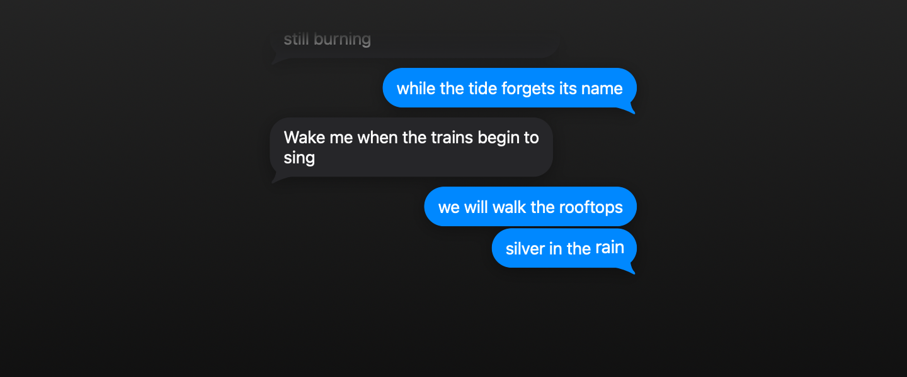
  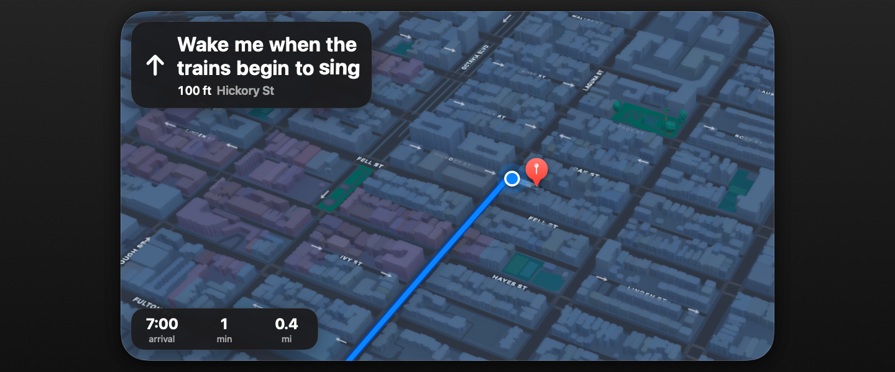
</p>
<p align="center">
  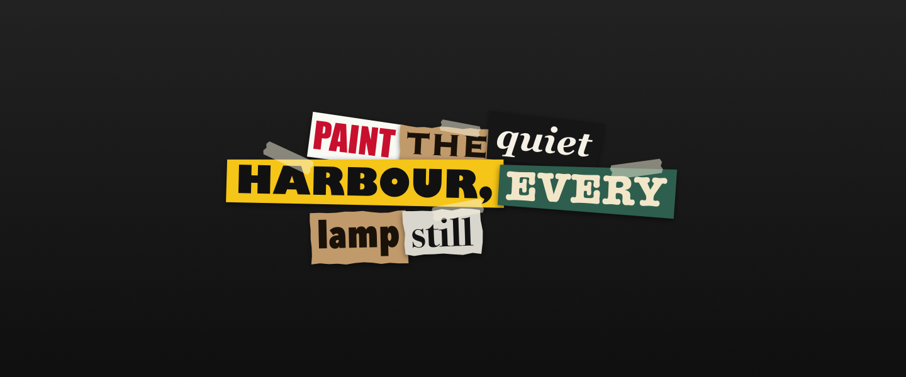
  
</p>
<p align="center">
  
  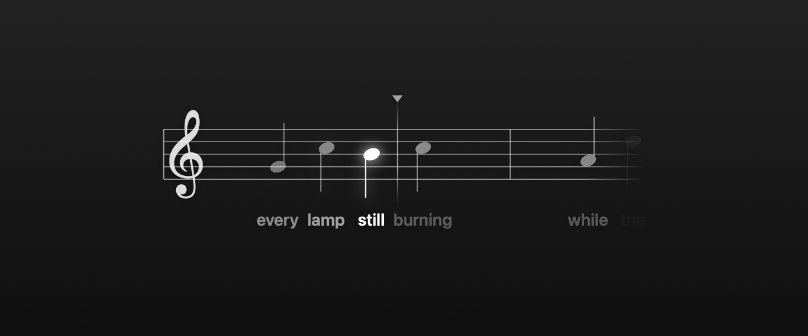
</p>
<p align="center">
  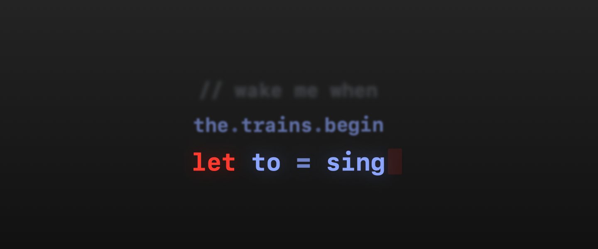
  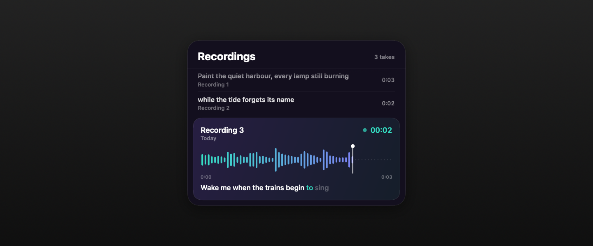
</p>

<p align="center"><sub>Frames drawn by <code>Stanza --render</code> with the app's built-in sample lyrics. All 23 are in <a href="docs/STYLES.md">docs/STYLES.md</a>.</sub></p>

## Using Stanza

### The window

<p align="center">
  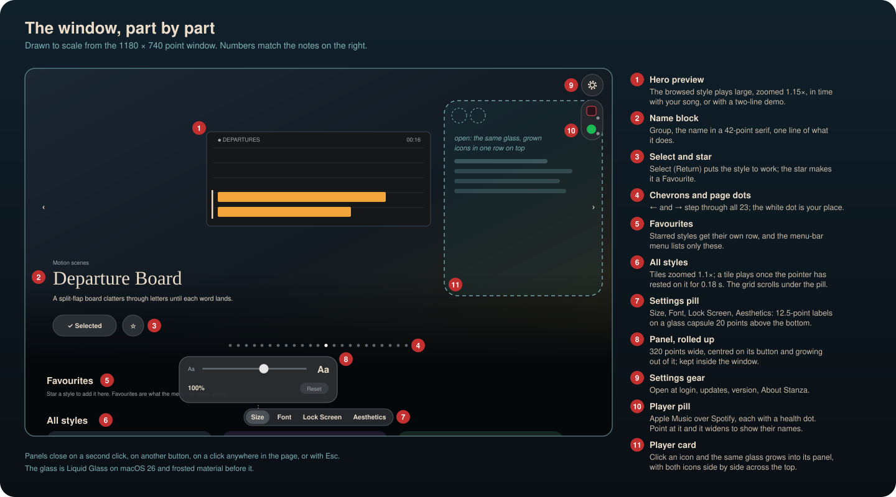
</p>

The window opens when Stanza starts and whenever you choose **Open Stanza** from the menu-bar icon. While it is open,
Stanza also has a Dock icon. The large preview at the top plays the style you are browsing; use the arrows (or ← and
→) or the dots to browse, **Select** (or Return) to use one, and the star to make it a Favourite. Below it,
Favourites have their own row of tiles above all the styles. A tile starts playing when you rest the pointer on it.

<p align="center">
  
</p>

<p align="center"><sub>The shelf of style tiles in the window, cropped to its first three rows; the Map tile sits below.</sub></p>

The slim pill floating at the bottom of the window holds the lyric settings: each button rolls its panel up out of
itself. The gear at the top right opens Settings. Below it, a slim vertical pill holds Apple Music and Spotify: point
at it and it widens to show their names; click one and the whole pill grows into that player's panel, with both icons
side by side across its top. A panel closes on a second click, on another button, on a click anywhere in the page, or
with Esc. Why the controls work this way is in [DESIGN.md](docs/DESIGN.md#interaction-design).

| Panel | What it holds |
|---|---|
| **Size** | The size of the whole style (words, cards and pictures), from 25% to 150%. |
| **Font** | SF Pro, SF Rounded, New York, Helvetica Neue, Avenir Next, Futura or Didot. Some styles bring their own type; see [STYLES.md](docs/STYLES.md#at-a-glance). |
| **Lock Screen** | Show lyrics when unlocked too, or on the lock screen only. Keep the screen from sleeping while a song plays. Turn each display on or off. |
| **Aesthetics** | Three colours (lyric text, highlight, secondary text) from the system colour picker, or colours taken from the album cover of each song. |
| **Spotify**, **Apple Music** | Connection status as numbered steps (player open, permission, playing, lyrics found), with a one-click fix for the step that is still open. Timing: a per-song nudge in 1-second steps (up to 20 seconds either way, forgotten at the next song) and a saved offset of up to 1 second for every song. |
| **Settings** (the gear) | Open Stanza at login. Install updates automatically. The version, and **Check Now**. **About Stanza**: credits and links. |

With the Map style browsed, two extra buttons choose **3D** or **Flat**, and whether the map fills the **Whole
display** or sits in a **Window**. A short first-run introduction covers the player, the permission and the choice of
style.

### The menu bar

The menu-bar icon is the logo mark. Its menu has:

- **Open Stanza**
- **Styles**: your Favourites (and the style in use) with **All Styles…** to open the window; with no Favourites
  yet, every style, grouped as Kinetic type, Motion scenes and Phone screens. The style in use is ticked.
- **Keep Screen Awake** and **Show When Unlocked**
- **Position and Size**: **Drag Position**, **Reset Position**, and the **Size** slider with **Reset Size**
- **Displays**: one item per connected display, to turn the lyrics on or off there
- **Check for Updates…**, which reads **Restart to Update** while a downloaded update waits
- **Quit Stanza**

### Favourites

Star a style on the large preview or on its tile. Starred styles get their own row in the window, and once there are
any, the menu-bar menu lists only those (plus the style in use), so it stays short however many styles there are.

### Drag Position and Size

**Drag Position** shows a slim Liquid Glass pill where the lyrics sit (a dark frosted pill before macOS 26): a move
symbol, the Size slider with its percentage, a reset button and a round Done button. Drag it anywhere; the lyrics
stay glued to it, even past the edge of the screen. Click Done (or choose Drag Position again) and the spot is kept on
every display and on the lock screen. **Reset Position** puts the lyrics back in the middle.

**Size** scales the whole style, from 25% to 150%. Every style was measured and balanced so that the same Size fills
about the same part of the screen whichever style you pick. Every Size slider, in the menu, on the pill and in the
window, also follows the mouse wheel and a two-finger swipe.

### Good to know

- The overlay steps aside on the display where the Stanza window is in use, so lyrics never play over their own
  previews.
- When the music has been paused for 10 seconds, the lyrics fade away; they come back as soon as it plays.
- Between lines most styles clear the screen. Departure Board, Receipt and the phone screens stay up through pauses,
  and some of them dim.
- With macOS **Reduce motion** on, most styles drop their decorative motion and the window's large preview holds
  still. The [table in STYLES.md](docs/STYLES.md#at-a-glance) shows which.

### Permissions

Stanza reads the current track and playback position from Spotify and Apple Music through AppleScript, which macOS
guards with an Automation permission per player. The first time, macOS asks; choose **Allow**. If the answer was
**Don't Allow**, the player panel has a button that opens Privacy & Security › Automation in System Settings, and an
**Ask for permission again** button that clears Stanza's saved answers (with `tccutil reset AppleEvents
tech.rayhanson.stanza`) so macOS asks from scratch.

Releases are signed with the same certificate every time, so macOS remembers your answer across updates. A copy you
build yourself is signed ad hoc, and macOS may ask again after each rebuild.

No other permission is needed. Stanza does not ask for your location, microphone, screen recording or accessibility.

## Status and limits

Version 0.4.4.

- **Not notarised.** Releases are signed with the project's own certificate, not an Apple developer identity, so the
  first time you open a downloaded copy macOS blocks it until you allow it (see [Install](#install)).
- **Apple silicon and macOS 15 or later.** The build targets `arm64-apple-macosx15.0` only.
- **The lock screen relies on a private API.** Drawing above the lock screen uses an undocumented window-server
  interface. Every call is looked up at run time and the app keeps working without it (lyrics then show only while
  the Mac is unlocked), but a macOS update could break it at any time.
- **The lyrics sources are not under this project's control.** The main source is an unofficial public endpoint of
  NetEase Cloud Music, with LRCLIB as the fallback. Either can change, limit or stop answering without notice. Some
  songs have no timed lyrics in either.
- **No CI.** `./build.sh` runs a built-in self-check of the parsing, matching, timing and layout logic after every
  build. There are no automated UI tests.

## Privacy and network

Stanza has no accounts, no analytics and no telemetry. These are the only things that leave your Mac:

| What | Where | When |
|---|---|---|
| Track title and artist | NetEase Cloud Music (`music.163.com`) and LRCLIB (`lrclib.net`), over HTTPS, without cookies | When a track has no cached lyrics. |
| Map tiles and walking directions | Apple Maps, through MapKit | The Map style walks a route through a built-in demo city; the Money style shows map pictures of a few well-known landmarks. This also happens for their previews in the window. Your location is never read. |
| An update check | GitHub (`github.com` and its download servers), over HTTPS | Once a day, and when you choose **Check for Updates…**. The request carries Stanza's version number, as any download does; no other system details are sent. |
| A request for the album cover | The address Spotify reports for the current track's cover, over HTTPS only | Only when **Colours from the album cover** is on or the Money or Notifications style is in use. Apple Music hands the cover over directly, with no request. |

On your Mac, Stanza keeps:

- `~/Library/Caches/Stanza`: found lyrics, and the words it has already matched to pictures. Safe to delete.
- `~/Library/Logs/Stanza.log`: a plain-text log of what the app did, including the artist and title of each track
  played and the names of your displays. It stays on your Mac and starts over once it passes about 1 MB.
- Its settings, in the standard user defaults for `tech.rayhanson.stanza`.

Word pictures are chosen on the Mac with Apple's Natural Language framework; no network is involved.

## Build from source

You need:

- A Mac with Apple silicon, on macOS 15 or later.
- Apple's Command Line Tools (`xcode-select --install`). Xcode is not needed.
- The Spotify desktop app or Apple Music.

```bash
git clone https://github.com/Rayhanson-Git/stanza.git
cd stanza
./build.sh
open build/Stanza.app
```

`build.sh` fetches the pinned version of Sparkle into `Vendor/` (once, checked against a fixed checksum), compiles
every file in `Sources/` with `swiftc`, assembles `build/Stanza.app`, signs it, and runs the self-check. It ends with
`self-check passed` and `Built build/Stanza.app`. Run the app from `build/`, or copy it to `/Applications` first if
you prefer (Open at login needs a copy in an Applications folder).

How the pieces fit together, from the AppleScript poll to the lock-screen window, is in
[docs/ARCHITECTURE.md](docs/ARCHITECTURE.md).

## Developer tools

The app binary doubles as a command-line tool for checking things without playing music. None of these commands
open the app or save settings.

```bash
APP=build/Stanza.app/Contents/MacOS/Stanza

$APP --self-check                                          # the assert-based checks that build.sh runs
$APP --lyrics "Example Artist" "Example Song" 215          # look a track up (artist, title, length in seconds)
$APP --render "Constellation" constellation.png 4          # one frame of a style with sample lyrics, at 4 s
$APP --render-gallery window.png none                      # the window, laid out offscreen
$APP --render-gallery shelf.png shelf                      # the full shelf of style tiles
$APP --render-tile "Web" web-tile.png                      # one shelf tile
```

- `--lyrics` makes real requests to the two lyrics services and caches what it finds.
- `--render` uses six invented sample lines that start at 1, 5, 9, 13, 15.5 and 30 seconds; between lines some styles
  draw nothing. The Map style waits up to 40 seconds for Apple Maps data.
- `--render-gallery` takes a view (`none`, `size`, `font`, `lockscreen`, `aesthetics`, `spotify`, `music`,
  `onboarding`, `onboarding-player`, `onboarding-style`, `onboarding-done`, `shelf`) and an optional size such as
  `1180x740`.
- To try a variant without touching your settings, add a launch-argument override at the end of the command (for
  `--render`, after the seconds), for example `-lyricStyle Constellation` or `-textScale '<real>1.2</real>'`.
- Known limit: the window picture is taken from its layers, which cannot draw 3D transforms, so in the large preview
  the tilted words of Ship, Visual and the Fisheye styles land in the wrong place. Use another style for that render.

The images in `assets/` were made this way. The style frames are `--render` output at Size 100% in SF Pro, cropped
to the lyric band (`sips -c 600 1440 --cropOffset 204 0`, since the band is centred 56% of the way down). The window
pictures are `--render-gallery` with the views `none`, `music` and `size`, and overrides that pin the look to the
defaults without touching your settings:

```bash
$APP --render-gallery assets/window.png none -pinnedStyles '<array/>' -lyricStyle 'Departure Board' \
  -textScale '<real>1</real>' -lyricOffsetX '<real>0</real>' -lyricOffsetY '<real>0</real>' -lyricFont 'SF Pro'
```

The diagrams in `assets/diagrams/` are hand-written SVG in the project's palette. The banner and social preview are
drawn from the style frames by `design/banner/banner.swift`:

```bash
swiftc -O -swift-version 5 -target arm64-apple-macosx15.0 design/banner/banner.swift -o /tmp/stanza-banner
/tmp/stanza-banner    # run from the repository root
```

## Releases

<p align="center">
  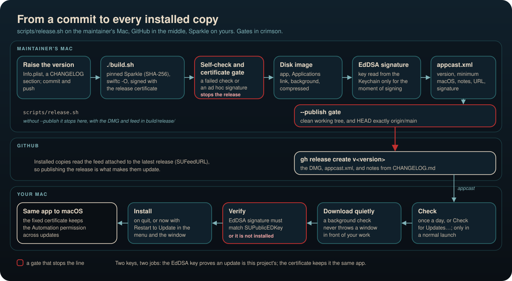
</p>

Updates use [Sparkle](https://sparkle-project.org). To make a release, raise `CFBundleShortVersionString` and
`CFBundleVersion` in `Info.plist`, add a section for the version to `CHANGELOG.md`, commit and push, then run:

```bash
scripts/release.sh             # build/release/Stanza-<version>.dmg and appcast.xml
scripts/release.sh --publish   # the same, then the GitHub release
```

The script builds the app, makes the disk image, signs it for the updater, writes the update feed with the
version's changelog section as its notes, and with `--publish` creates the GitHub release, but only from a clean
working tree that matches `origin/main`. Installed copies read the feed attached to the latest release, so publishing
a release is what makes them update. The whole pipeline is described in
[docs/ARCHITECTURE.md](docs/ARCHITECTURE.md#updates-and-releases).

Two keys live in the maintainer's login Keychain, never in this repository:

- **The update key.** A private EdDSA key signs each disk image, and installed copies only accept updates that carry
  its signature. It was made once with `Vendor/Sparkle-*/bin/generate_keys --account tech.rayhanson.stanza`; its
  public half is `SUPublicEDKey` in `Info.plist`.
- **The code-signing certificate** "Stanza Release Signing". `build.sh` signs with it when it is in the Keychain, and
  ad hoc otherwise; `scripts/release.sh` refuses to publish without it, so every release keeps the same identity.

Both are backed up outside this Mac. On a new Mac, import the certificate's `.p12` file into the login Keychain (allow
`/usr/bin/codesign` to use its key) and restore the update key with `generate_keys --account tech.rayhanson.stanza -f
<file>`.

## Project layout

```text
Sources/            the app: 65 Swift files, about 17,000 lines
  main.swift          entry point and the command-line tools
  AppDelegate.swift   the menu-bar menu and app lifecycle
  NowPlayingMonitor.swift, PlayerLink.swift   reading the players, and the permission steps
  LyricsProvider.swift, LyricsParsing.swift   finding, matching, parsing and caching lyrics
  LyricEngine.swift   the lyric clock and timing offsets
  OverlayView.swift, OverlayWindows.swift     the styles list, the shared stage and the lock-screen windows
  LyricPlacement.swift                        Drag Position
  *Style.swift and their helpers              how each style draws (WordStackStyle.swift covers the stacks)
  Gallery*.swift, PlayerPanel.swift, OnboardingView.swift   the window
  AppUpdater.swift, UpdateViews.swift        the updater, and its controls in the menu and window
  SelfCheck.swift, GallerySelfCheck.swift     the self-check
Resources/          app icon, logo, menu-bar mark and the disk-image background
Info.plist          bundle ID tech.rayhanson.stanza, macOS 15 minimum, the update feed and key
build.sh            fetch Sparkle, build, sign, self-check
scripts/release.sh  disk image, update signature, feed and GitHub release
CHANGELOG.md        what changed in each version
docs/               DESIGN.md (why it looks and moves as it does), ARCHITECTURE.md (how it works), STYLES.md (every style)
design/logo/        the script that draws the logo and icon, and the exploration sheet of forms
design/banner/      the script that draws the README banner and the social preview
design/dmg/         the script that draws the disk-image background
assets/             README and docs images; assets/diagrams/ holds the SVG diagrams
```

The logo, called Quatrain, is drawn in code by `design/logo/quatrain_variations.swift`; its header explains how to
rebuild the icon. [`design/logo/quatrain_forms.png`](design/logo/quatrain_forms.png) shows the forms that were
considered.

## Licence

[MIT](LICENSE). Made by Harvey Rayhanson ([rayhanson.tech](https://rayhanson.tech)).
