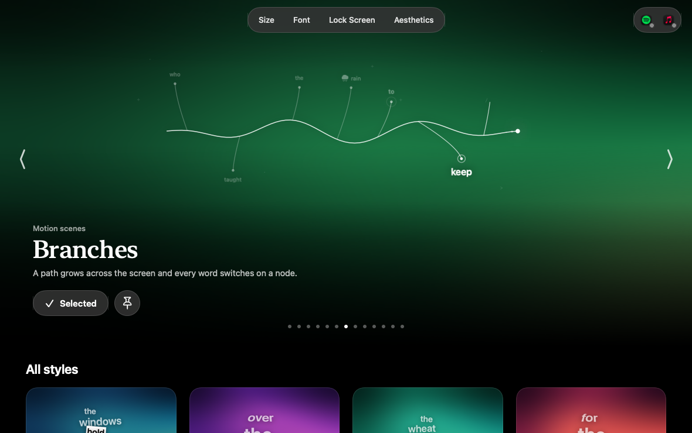
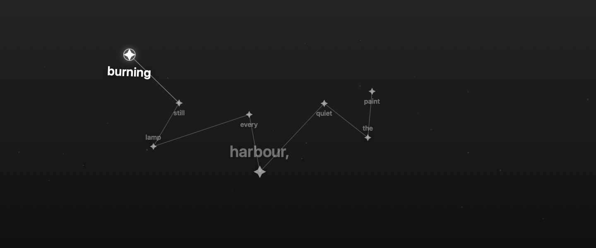
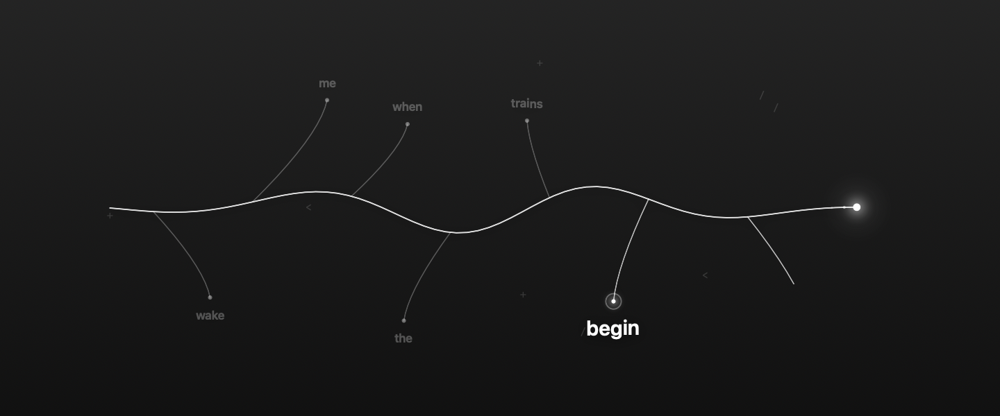
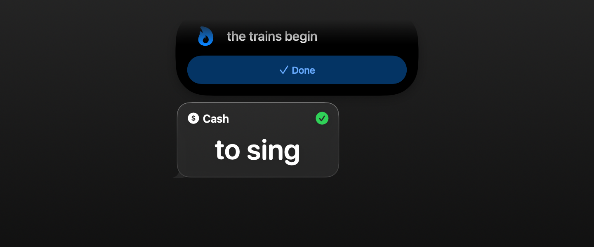
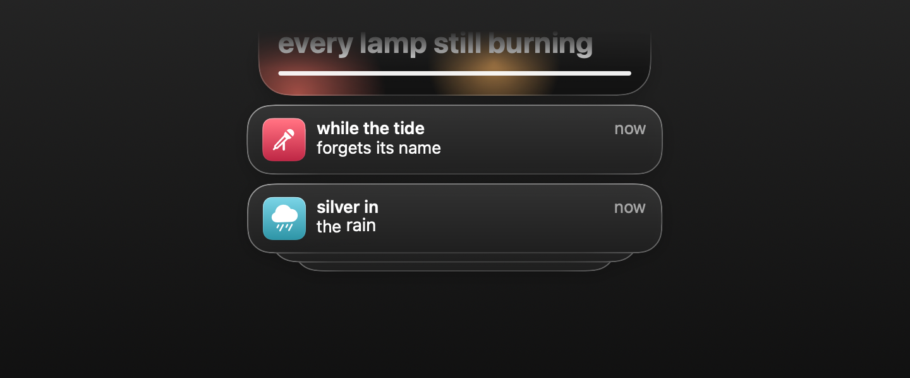
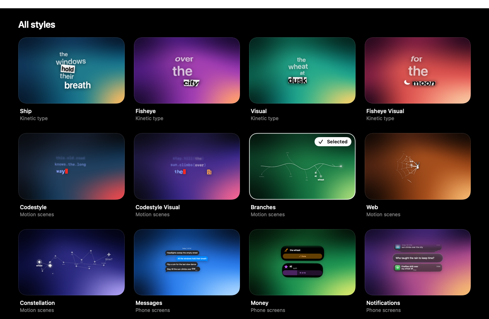

<p align="center">
  
</p>

<h1 align="center">Stanza</h1>

<p align="center"><b>The song you are playing, sung word by word across your Mac's desktop and lock screen.</b></p>

<p align="center">
  
  
  
  
  
  
</p>

<p align="center">
  <a href="#about">About</a> |
  <a href="#status-and-limits">Status and limits</a> |
  <a href="#features">Features</a> |
  <a href="#install">Install</a> |
  <a href="#build-from-source">Build from source</a> |
  <a href="#usage">Usage</a> |
  <a href="#how-it-works">How it works</a> |
  <a href="#privacy-and-network">Privacy and network</a> |
  <a href="#developer-tools">Developer tools</a> |
  <a href="#project-layout">Project layout</a> |
  <a href="#licence">Licence</a>
</p>

## About

Stanza is a small macOS menu-bar app for people who like to see the words of a song while it plays. It follows the
track playing in Spotify or Apple Music, finds lyrics timed to the song, and draws them over the desktop and above
the lock screen, one word at a time, as they are sung.

There are 13 ways to draw the words. Some are kinetic type: words that stack, swell and settle. Some are small motion
scenes: a path that grows a branch per word, a spider web, a star chart, lines typed out as code. Four imitate a phone
screen: the song arrives as a chat thread, a run of payments, a pile of lock-screen alerts, or a walk across a city
map. A main window plays every style as a live preview, so you can pick one by watching it.

<p align="center">
  
</p>

What you get:

- **Lyrics where you look.** Above the lock screen, and over the desktop too if you like, on every display or only the ones you choose.
- **Word-level timing.** Each word appears when it is sung; songs that only have line timing get an estimated time for each word.
- **Thirteen styles, live.** Every style plays in the window before you pick it, and all of them are a click away in the menu bar.
- **Your look.** Text size, seven fonts, three colours of your own or colours taken from the album cover.
- **A guided setup.** The window shows what each player still needs, with a button for the next step.
- **Timing you can correct.** Nudge one song a second earlier or later, or set a standing offset for every song.

## Status and limits

Version 0.3.1. Download it from [Releases](https://github.com/Rayhanson-Git/stanza/releases/latest), or build it from
source. It keeps itself up to date.

- **Built with Apple's Command Line Tools.** `build.sh` calls `swiftc` directly. Xcode is not needed.
- **Apple silicon and macOS 15 or later.** The build targets `arm64-apple-macosx15.0` only.
- **Not notarised.** Stanza is signed without an Apple developer identity. The first time you open a downloaded copy,
  macOS blocks it until you allow it in System Settings (see [Install](#install)). For the same reason macOS asks for
  Automation permission before Stanza can read Spotify or Apple Music, and may ask again after an update or rebuild,
  because the signature changes.
- **The lock screen relies on a private API.** Drawing above the lock screen uses an undocumented window-server
  interface. Every call is looked up at runtime and the app keeps working without it (lyrics then show only while the
  Mac is unlocked), but a macOS update could break it at any time.
- **The lyrics sources are not under this project's control.** The main source is an unofficial public endpoint of
  NetEase Cloud Music, with LRCLIB as the fallback. Either can change, limit or stop answering without notice. Some
  songs have no timed lyrics in either.
- **No CI.** `./build.sh` runs a built-in self-check of the parsing, matching, timing and layout logic after every
  build. There are no automated UI tests.

## Features

<p align="center">
  
</p>

The window (the gallery) plays one style large at the top, the one in use or the one you are browsing, with every style in a grid of tiles below it. Each preview
runs through `LyricStage`, the same view that draws the real overlay, so what you see in the window is what you get.

### Styles

| Style | Group | What it does |
|---|---|---|
| Ship | Kinetic type | Every word settles onto a wall that sways slowly in space. |
| Fisheye | Kinetic type | Three stacked words, swollen in the middle like a glass lens. |
| Visual | Kinetic type | A centred column of words, with a small picture where one fits. |
| Fisheye Visual | Kinetic type | The lens stack, plus pictures next to the words that earn one. |
| Codestyle | Motion scenes | Lyrics typed out like source code behind a blinking red cursor. |
| Codestyle Visual | Motion scenes | The code look, plus pictures next to the words that earn one. |
| Branches | Motion scenes | A path grows across the screen and every word switches on a node. |
| Web | Motion scenes | Each line becomes a spider web, one thread per word. |
| Constellation | Motion scenes | Each line is joined up as a star pattern, one star per word. |
| Messages | Phone screens | The song arrives as a chat thread, one bubble per line. |
| Money | Phone screens | Each line shows up as a payment, a card or a tap to pay. |
| Notifications | Phone screens | Lines land as lock-screen alerts, piles and widgets. |
| Map | Phone screens | A stroll through the city that drops a pin for each line. |

<p align="center">
  
  
</p>
<p align="center">
  
  
</p>
<p align="center">
  
  
</p>
<p align="center">
  
  
</p>

<p align="center"><sub>Frames drawn by <code>Stanza --render</code> with the app's built-in sample lyrics.</sub></p>

<p align="center">
  
</p>

<p align="center"><sub>The shelf of style tiles in the window, cropped to its first three rows; the Map tile sits below.</sub></p>

### Settings

| Panel | What it holds |
|---|---|
| **Size** | Lyric size from 50% to 150%. |
| **Font** | SF Pro, SF Rounded, New York, Helvetica Neue, Avenir Next, Futura or Didot. The phone-screen styles keep the system typeface. |
| **Lock Screen** | Show lyrics when unlocked too, or on the lock screen only. Keep the screen from sleeping while a song plays. Turn each display on or off. |
| **Aesthetics** | Three colours (lyric text, highlight, secondary text) from the system colour picker, or colours taken from the album cover of each song. The phone-screen styles bring their own colours. |
| **Spotify**, **Apple Music** | Connection status as numbered steps (player open, permission, playing, lyrics found), with a one-click fix for the step that is still open. A per-song nudge in 1-second steps (up to 20 seconds either way, forgotten at the next song) and a saved offset of up to 1 second for every song. |

Other details:

- The Map style can lean the city over in 3D or look straight down, and can fill the display or sit in a window.
- Styles can be pinned; pinned styles are listed first in the menu-bar menu.
- With macOS "Reduce motion" on, styles drop their decorative wobble.
- The overlay steps aside on the display where the Stanza window is open, so lyrics never play over their own previews.
- A short first-run introduction in the window covers the player, the permission and the choice of style.

## Install

1. Open the [latest release](https://github.com/Rayhanson-Git/stanza/releases/latest) and download
   **Stanza-&lt;version&gt;.dmg**.
2. Open the disk image and drag **Stanza** into **Applications**. Open it from Applications, not from the disk image.
3. The first time, macOS says it cannot check Stanza for malicious software, because Stanza is not notarised by Apple.
   Click **Done**, then open **System Settings → Privacy & Security**, scroll down and click **Open Anyway** next to
   Stanza.

Stanza then updates itself. Once a day it looks for a new version, downloads it quietly and installs it the next time
Stanza restarts. While an update waits, the menu-bar menu and the window offer **Restart to Update**. Choose **Check
for Updates…** at any time, or switch off automatic installs at the bottom of the window. Updates are only installed
when they carry this project's signature. What changed in each version is in [CHANGELOG.md](CHANGELOG.md).

## Build from source

You need:

- A Mac with Apple silicon, on macOS 15 or later.
- Apple's Command Line Tools (`xcode-select --install`).
- The Spotify desktop app or Apple Music.

```bash
git clone https://github.com/Rayhanson-Git/stanza.git
cd stanza
./build.sh
open build/Stanza.app
```

`build.sh` compiles every file in `Sources/` with `swiftc`, assembles `build/Stanza.app`, signs it ad hoc, and runs
the self-check. It ends with `self-check passed` and `Built build/Stanza.app`. Run the app from `build/`, or copy it
to `/Applications` first if you prefer.

## Usage

### The window

The window opens when Stanza starts and whenever you choose **Open Stanza** from the menu-bar icon. While it is open,
Stanza also has a Dock icon. Use the arrows or the dots to browse the styles in the large preview, **Select** to use
one, and the pin button to keep it at the top of the menu-bar menu. The panels across the top hold the settings; the
player icons at the top right open the Spotify and Apple Music panels. At the bottom of the window are the version,
**Check for Updates…** and the switch for automatic updates.

### The menu bar

The menu-bar icon is the logo mark. Its menu has:

- **Open Stanza**
- **Styles**: every style, grouped as Kinetic type, Motion scenes and Phone screens, with any pinned styles first.
  The style in use is ticked.
- **Keep Screen Awake** and **Show When Unlocked**
- **Text Size**: a slider with a Reset button
- **Displays**: one item per connected display, to turn the lyrics on or off there
- **Check for Updates…**, which reads **Restart to Update** while a downloaded update waits
- **Quit Stanza**

### Permissions

Stanza reads the current track and playback position from Spotify and Apple Music through AppleScript, which macOS
guards with an Automation permission per player. The first time, macOS asks; choose **Allow**. If the answer was
**Don't Allow**, the player panel has a button that opens Privacy & Security › Automation in System Settings, and an
**Ask for permission again** button that clears Stanza's saved answers (with `tccutil reset AppleEvents
tech.rayhanson.stanza`) so macOS asks from scratch. Because the app is signed ad hoc, a rebuild can make macOS ask
again.

No other permission is needed. Stanza does not ask for your location, microphone, screen recording or accessibility.

## How it works

1. **Now playing.** Every half second, Stanza asks Spotify or Apple Music over AppleScript which track is playing,
   where it is, and whether it is paused.
2. **Lyrics.** For a new track it checks its disk cache, then searches NetEase Cloud Music for word-timed lyrics,
   then falls back to that service's line-timed lyrics, then to LRCLIB. A result counts only when the title words,
   an artist word and the duration (within 3 seconds) match. Line-timed lyrics are spread across their words by
   letter count. Translation lines are dropped.
3. **Timing.** The playback position, the standing offset and the per-song nudge decide which line and which word
   are current at each frame.
4. **Drawing.** One transparent, click-through window covers each enabled display. It is placed in a window-server
   space that sits above the lock screen, so it stays visible after you lock the Mac. The same `LyricStage` view
   draws this overlay and every preview in the window.
5. **Word pictures.** The Visual styles, Branches, Money and Notifications add small SF Symbols or emoji next to some
   words. They come from a built-in table, the system's own symbol search keywords, and an on-device word model from
   Apple's Natural Language framework. No network is involved.

## Privacy and network

Stanza has no accounts, no analytics and no telemetry. These are the only things that leave your Mac:

| What | Where | When |
|---|---|---|
| Track title and artist | NetEase Cloud Music (`music.163.com`) and LRCLIB (`lrclib.net`), over HTTPS, without cookies | When a track has no cached lyrics. |
| Map tiles and walking directions | Apple Maps, through MapKit | The Map style walks a route through a built-in demo city; the Money style shows map pictures of a few well-known landmarks. This also happens for their previews in the window. Your location is never read. |
| An update check | GitHub (`github.com` and its download servers), over HTTPS | Once a day, and when you choose **Check for Updates…**. The request carries Stanza's version number, as any download does; no other system details are sent. |
| A request for the album cover | The address Spotify reports for the current track's cover, over HTTPS only | Only when **Colours from the album cover** is on or the Money or Notifications style is in use. Apple Music hands the cover over directly, with no request. |

On your Mac, Stanza keeps:

- `~/Library/Caches/Stanza`: found lyrics, and the words it has already matched to pictures. Safe to delete.
- `~/Library/Logs/Stanza.log`: a plain-text log of what the app did, including the artist and title of each track
  played and the names of your displays. It stays on your Mac and starts over once it passes about 1 MB.
- Its settings, in the standard user defaults for `tech.rayhanson.stanza`.

## Developer tools

The app binary doubles as a command-line tool for checking things without playing music. None of these commands
open the app or save settings.

```bash
APP=build/Stanza.app/Contents/MacOS/Stanza

$APP --self-check                                          # the assert-based checks that build.sh runs
$APP --lyrics "Example Artist" "Example Song" 215          # look a track up (artist, title, length in seconds)
$APP --render "Constellation" constellation.png 4          # one frame of a style with sample lyrics, at 4 s
$APP --render-gallery window.png none                      # the window, laid out offscreen
$APP --render-gallery shelf.png shelf                      # the full shelf of style tiles
$APP --render-tile "Web" web-tile.png                      # one shelf tile
```

- `--lyrics` makes real requests to the two lyrics services and caches what it finds.
- `--render` uses six invented sample lines that start at 1, 5, 9, 13, 15.5 and 30 seconds; between lines some styles
  draw nothing. The Map style waits up to 40 seconds for Apple Maps data.
- `--render-gallery` takes a view (`none`, `size`, `font`, `lockscreen`, `aesthetics`, `spotify`, `music`,
  `onboarding`, `onboarding-player`, `onboarding-style`, `onboarding-done`, `shelf`) and an optional size such as
  `1180x740`.
- To try a variant without touching your settings, add a launch-argument override at the end of the command (for
  `--render`, after the seconds), for example `-lyricStyle Constellation` or `-textScale '<real>1.2</real>'`.
- Known limit: the window picture is taken from its layers, which cannot draw 3D transforms, so in the large preview
  the tilted words of Ship, Visual and the Fisheye styles land in the wrong place. Use another style for that render.

The images in `assets/` were made this way. The style frames are `--render` output cropped to the lyric band
(`sips -c 600 1440`), and the banner and social preview are drawn from them by `design/banner/banner.swift`:

```bash
swiftc -O -swift-version 5 -target arm64-apple-macosx15.0 design/banner/banner.swift -o /tmp/stanza-banner
/tmp/stanza-banner    # run from the repository root
```

### Releases

Updates use [Sparkle](https://sparkle-project.org). `build.sh` downloads the pinned Sparkle version into `Vendor/`
(not committed) and checks it against a fixed checksum. To make a release, raise `CFBundleShortVersionString` and
`CFBundleVersion` in `Info.plist`, add a section for the version to `CHANGELOG.md`, commit and push, then run:

```bash
scripts/release.sh             # build/release/Stanza-<version>.dmg and appcast.xml
scripts/release.sh --publish   # the same, then the GitHub release
```

The disk image is signed with a private EdDSA key kept in the maintainer's login Keychain (made once with
`Vendor/Sparkle-*/bin/generate_keys --account tech.rayhanson.stanza`); the matching public key is `SUPublicEDKey` in
`Info.plist`. Installed copies read the feed attached to the latest release, so publishing a release is what makes
them update.

## Project layout

```text
Sources/            the app: 50 Swift files, about 12,400 lines
  main.swift          entry point and the command-line tools
  AppDelegate.swift   the menu-bar menu and app lifecycle
  NowPlayingMonitor.swift, PlayerLink.swift   reading the players, and the permission steps
  LyricsProvider.swift, LyricsParsing.swift   finding, matching, parsing and caching lyrics
  LyricEngine.swift   the lyric clock and timing offsets
  OverlayView.swift, OverlayWindows.swift     the styles list, the shared stage and the lock-screen windows
  *Style.swift and their helpers              how each style draws (WordStackStyle.swift covers the kinetic type)
  Gallery*.swift, PlayerPanel.swift, OnboardingView.swift   the window
  AppUpdater.swift, UpdateViews.swift        the updater, and its controls in the menu and window
  SelfCheck.swift, GallerySelfCheck.swift     the self-check
Resources/          app icon, logo, menu-bar mark and the disk-image background
Info.plist          bundle ID tech.rayhanson.stanza, macOS 15 minimum, the update feed and key
build.sh            fetch Sparkle, build, sign ad hoc, self-check
scripts/release.sh  disk image, update signature, feed and GitHub release
CHANGELOG.md        what changed in each version
design/logo/        the script that draws the logo and icon, and the exploration sheet of forms
design/banner/      the script that draws the README banner and the social preview
design/dmg/         the script that draws the disk-image background
assets/             README images
```

The logo, called Quatrain, is drawn in code by `design/logo/quatrain_variations.swift`; its header explains how to
rebuild the icon. [`design/logo/quatrain_forms.png`](design/logo/quatrain_forms.png) shows the forms that were
considered.

## Licence

[MIT](LICENSE). Made by Harvey Rayhanson (Rayhanson-Git).
