<p align="center">
  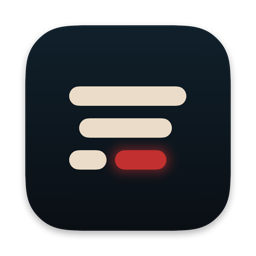
</p>

<h1 align="center">How Stanza works</h1>

<p align="center">From a song playing in Spotify or Apple Music to words on the lock screen, end to end.</p>

<p align="center">
  <a href="../README.md">README</a> |
  <a href="STYLES.md">Styles</a> |
  <a href="DESIGN.md">Design</a> |
  <a href="#the-big-picture">Big picture</a> |
  <a href="#song-starts-lyrics-on-screen">Song to screen</a> |
  <a href="#the-per-frame-render-pipeline">Per frame</a> |
  <a href="#updates-and-releases">Updates</a> |
  <a href="#data-and-settings">Data</a> |
  <a href="#key-design-decisions">Decisions</a>
</p>

Stanza is one Swift executable of about 17,000 lines in 65 files under `Sources/`, built by `./build.sh` with
`swiftc` and Apple's Command Line Tools. It uses AppKit for the menu bar, windows and system services, SwiftUI for
everything drawn, and one third-party framework, Sparkle, for updates. This page explains how the parts fit
together and why they are built the way they are. File names are given so you can read along; everything here
describes the current code. Why the app looks and moves the way it does is in [DESIGN.md](DESIGN.md).

## Contents

- [The big picture](#the-big-picture)
- [Start-up](#start-up)
- [Reading the player](#reading-the-player)
- [Finding lyrics](#finding-lyrics)
- [Keeping time](#keeping-time)
- [Song starts, lyrics on screen](#song-starts-lyrics-on-screen)
- [Drawing above the lock screen](#drawing-above-the-lock-screen)
- [The per-frame render pipeline](#the-per-frame-render-pipeline)
- [Drag Position and Size](#drag-position-and-size)
- [The window](#the-window)
- [Colours from the album cover](#colours-from-the-album-cover)
- [Updates and releases](#updates-and-releases)
- [Open at login](#open-at-login)
- [Keyboard shortcuts](#keyboard-shortcuts)
- [Data and settings](#data-and-settings)
- [Building and checking](#building-and-checking)
- [Key design decisions](#key-design-decisions)
- [Source map](#source-map)

## The big picture

<p align="center">
  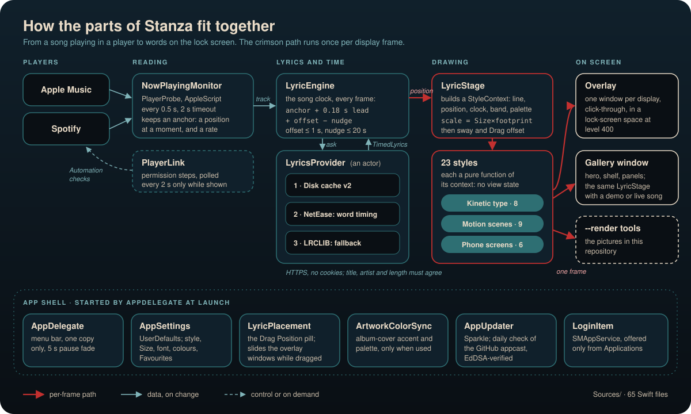
</p>

The same map as a Mermaid graph, with every connection:

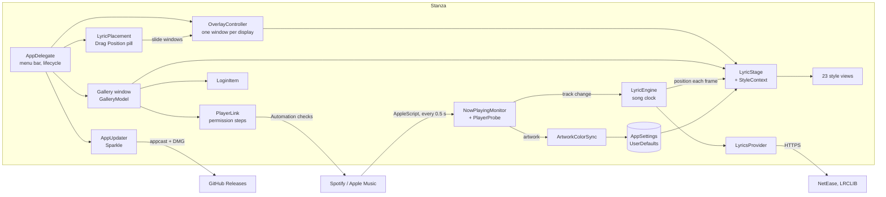

There are two ways the words reach the screen, and they share one view. The **overlay** is a set of transparent,
click-through windows, one per display, that sit above everything including the lock screen. The **window** (the
gallery) is an ordinary Mac window that previews every style. Both draw through `LyricStage`, so a preview cannot
drift from the real thing.

## Start-up

`main.swift` first checks for a command-line tool (`--self-check`, `--lyrics`, `--render`, `--render-gallery`,
`--render-tile`). Those run and exit without starting the app, without the updater and without writing settings.
Otherwise it starts `NSApplication` as an accessory app (menu bar only) with `AppDelegate`.

`AppDelegate.applicationDidFinishLaunching` (`Sources/AppDelegate.swift`):

1. **One copy only.** If another Stanza is running, the later launch quits (ties go to the lower process number, so
   two copies started together never both exit).
2. Builds the menu-bar menu and a small main menu (so ⌘Q, ⌘H, ⌘W and ⌘M work while the window is open).
3. Starts the updater, the `LockMonitor`, and the overlay windows.
4. Subscribes to display changes, the settings that affect visibility, and play/pause.
5. Starts polling the players and shows the window.

The menu's Styles and Displays sections are rebuilt each time the menu opens (`menuNeedsUpdate`), so they always
match the current Favourites and connected displays.

## Reading the player

**`NowPlayingMonitor` and `PlayerProbe`** (`Sources/NowPlayingMonitor.swift`). Every half second, on a serial queue
of its own (`NSAppleScript` is not thread-safe), the probe asks each running player for the track's name, artist and
duration, the position and whether it is playing. Details that matter:

- The script starts with "if application is not running then return", so a player that just quit is not relaunched.
- Each query has a 2-second AppleScript timeout, so a hung player cannot freeze the lyrics.
- Fields are separated by ASCII character 31, which cannot appear in a title, and times are sent as whole
  milliseconds, so no locale's decimal separator can break parsing.
- The sample is timestamped at the middle of the round trip.
- A poll is skipped if the previous one has not answered, so a slow player never builds a backlog.
- If both players are open, the one that is playing wins.

The monitor keeps an **anchor**: a known position at a known moment, and a rate (1 while playing, 0 when paused).
Every frame extrapolates from it. A new sample only replaces the anchor when it disagrees by more than 0.25 s, or the
track, or play/pause, changed. That keeps the lyrics smooth between polls without jitter, while a seek takes effect
at the next poll.

**`PlayerLink`** (`Sources/PlayerLink.swift`, with `PlayerSteps.swift`) drives the player panels in the window: is
the player installed, open, readable, playing, and are there lyrics? It asks macOS for the Automation permission
with `AEDeterminePermissionToAutomateTarget`, opens the right page of System Settings, and can clear Stanza's saved
answers with `tccutil reset AppleEvents` so macOS asks again. It only polls (every 2 s) while a panel is showing the
result. `PlayerSteps` turns the facts into the numbered steps and is pure, so its wording is covered by the
self-check.

## Finding lyrics

When the track changes, `LyricEngine` asks `LyricsProvider` (`Sources/LyricsProvider.swift`, an `actor`) for timed
lyrics, cancelling any lookup still running for the previous track.

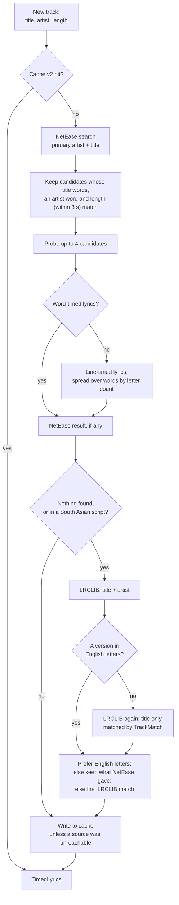

In words:

- **Cache.** Lyrics are cached on disk under `~/Library/Caches/Stanza/Lyrics/v2/`, one JSON file per track, named by
  a SHA-256 of artist, title and rounded length. "v2" exists so songs found before English-letter versions were
  preferred are looked up once more.
- **NetEase first.** NetEase Cloud Music is searched with the first credited artist and the normalised title. A
  candidate must match on title words (whole words, either way round), share a distinctive artist word, and be
  within 3 seconds of the track's length (`TrackMatch`). Exact titles come first, then the closest length. Up to four
  candidates are probed for word-timed lyrics (`yrc`); failing that, the first line-timed version (`lrc`) is used.
- **LRCLIB as fallback, and for English letters.** If NetEase found nothing, or found lyrics in a South Asian script
  (Hindi, Urdu, Punjabi, Bengali and the other scripts from Devanagari to Malayalam), LRCLIB is asked by title and
  artist. If none of its matches is written in English (Roman) letters, it is asked again by title alone, because
  LRCLIB's own search is strict about the artist name, and `TrackMatch` decides which entries are the same song. A
  version in English letters wins; otherwise NetEase's result stands, or the first LRCLIB match.
- **Not caching guesses.** Estimated timing that was only used because NetEase was unreachable is not cached, so the
  next play gets another chance at word timing. Nor is anything cached while LRCLIB could not be asked for an
  English-letter version.
- **Requests** go through an ephemeral `URLSession` with cookies off and a 15-second timeout.

`LyricsParsing` (`Sources/LyricsParsing.swift`) is pure text-to-timing code: it parses word-timed and line-timed
formats, drops credit lines ("Producer: …", "作词: …"), glues stray punctuation onto words, numbers lines in start
order so duets stay whole, drops Chinese translation lines printed alongside a non-Chinese original, and spreads a
line's time across its words by letter count, capped so a line before a long gap does not crawl. It has no state and
no network, and the self-check covers it.

## Keeping time

`LyricEngine` (`Sources/LyricEngine.swift`) answers one question for every frame: where are we in the song?

```
position = anchor extrapolated to this frame
         + 0.18 s display lead     (a word lands as it is heard)
         + standing offset         (saved, up to 1 s either way)
         - this song's nudge       (1 s steps, up to 20 s either way, forgotten at the next song)
```

`TimedLyrics` (`Sources/Model.swift`) holds the words and their lines. `activeLine(at:)` finds the line being sung:
the last line that has started, if its last word ended less than 0.8 s ago (`Timing.lineLinger`). Lines are found by
start order inside consecutive slices of the word list, which keeps overlapping duet lines from interleaving.
`line(at:alwaysDrawn:)` keeps a line alive through gaps for the styles that draw the whole song.

## Song starts, lyrics on screen

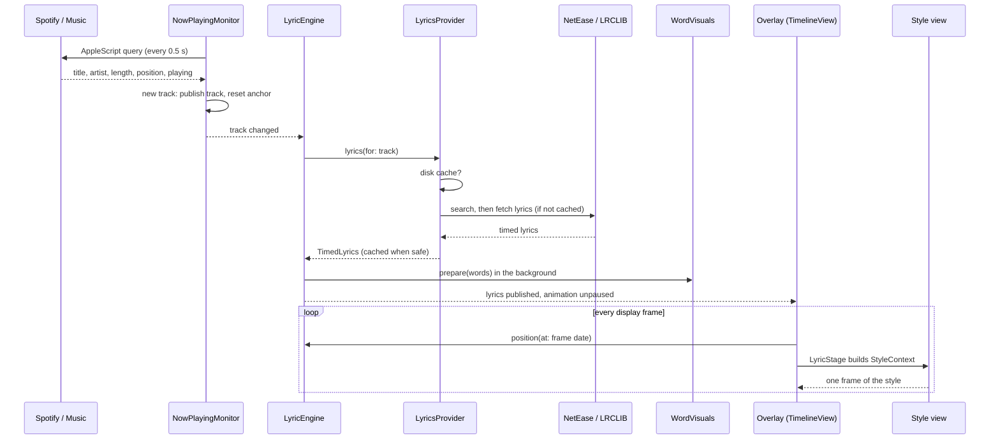

## Drawing above the lock screen

**`OverlayController`** (`Sources/OverlayWindows.swift`) keeps one borderless window per enabled display:
transparent, without a shadow, ignoring the mouse (so everything under it still works), on every Space, allowed to
show before login (`canBecomeVisibleWithoutLogin`), at a level just under the top. Windows are created, removed and
re-framed whenever displays change or one is switched off in the menu.

**The lock-screen space.** A normal window, at any level, sits below the lock screen. `LockScreenSpace` asks the
window server (the private SkyLight framework) for a space of its own and sets that space's absolute level to the
one used for notifications on the lock screen (400). Each overlay window is moved into it. Every function is looked
up at run time with `dlopen` and `dlsym`; if any is missing, `LockScreenSpace` is nil, the log says so, and lyrics
simply show only while the Mac is unlocked. This undocumented window-server interface is the part of Stanza a macOS
update is most likely to break.

**When the overlay shows.** A window is ordered in when the screen is locked, or when **Show When Unlocked** is on,
except on the display where the Stanza window is in use, so lyrics never play on top of their own previews. While
music plays and lyrics can be seen, `ScreenAwake` holds a power assertion so the display does not sleep (if **Keep
Screen Awake** is on). `LockMonitor` learns about locking from distributed notifications, with a once-a-second poll
as a safety net.

**Costing nothing when idle.** The overlay view is a `TimelineView(.animation)` that is paused when there are no
lyrics, nothing is playing, the window has the display, or the music has been paused for 5 seconds (when the whole
overlay also fades away). A paused timeline does not redraw.

## The per-frame render pipeline

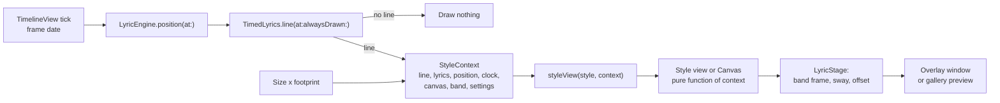

1. **`LyricOverlayView`** (`Sources/OverlayView.swift`) receives a frame date from its `TimelineView` and asks the
   engine for the song position.
2. **`LyricStage`** picks the line for that position. Styles that keep history (the six phone screens) or keep their
   card through gaps (Departure Board, Receipt) always get one; the others draw nothing between lines.
3. It builds a **`StyleContext`**: the line and how many of its words have started, the whole song, the position, the
   wall clock, the canvas size, the lyric band (56% of the screen tall), the settings, the track's title and artist,
   the album-cover palette and the **scale**.
4. The scale is **Size times the style's footprint** (`LyricStyle.footprint`), so every style fills about the same
   box at the same Size. The full-display Map is the exception: it stays full size and scales only its text.
5. **`styleView`** (`Sources/Diagnostics.swift`) switches on the style and returns its view. Each style is a pure
   function of the context: most draw into one SwiftUI `Canvas`, the stack styles use ordinary views.
6. `LyricStage` frames the result in the band, applies the slow 3D sway (Ship, Visual), and positions it at the
   default centre plus the Drag Position offset.

The gallery's previews call the same `LyricStage` with a demo song or the live one. `--render` calls it too, over a
grey gradient, which is how the pictures in this repository are made. How each style draws its frame is in
[STYLES.md](STYLES.md).

## Drag Position and Size

**Drag Position** (`Sources/LyricPlacement.swift`) shows a slim pill on the menu-bar display: a move symbol, the
Size slider with its percentage, a reset button and a round Done button. On macOS 26 it is Liquid Glass
(`NSGlassEffectView`); before that, a dark frosted pill. The pill is a non-activating panel moved into the lyrics'
own lock-screen space, one level above them; that is the only way to get anything in front of the lyrics.

While the pill is dragged, the lyrics do not re-render. Instead, every overlay window **slides** by the same share of
its display (`OverlayController.slide(by:)`), which costs nothing, so the lyrics stay glued to the pill. When it is
let go, the offset is saved once, as a fraction of the screen from the centre, and the windows are put back in the
same transaction with the lyrics already redrawn at their new spot, so nothing jumps. The saved offset applies on
every display and on the lock screen. Offsets may go up to half a screen past an edge, so the lyrics can sit partly
off screen; Reset Position brings them back.

**Size** runs from 25% to 150%. The menu, the pill and the window share one hand-drawn slider (`SizeSlider`) that
always looks live and takes the first click even when Stanza is not the active app, which a standard slider in a
menu does not. It throttles updates while dragging, since each change redraws every visible style, and follows the
mouse wheel or a two-finger swipe (`ScrollAdjust`).

## The window

The window is opened at launch and from **Open Stanza**. While it is open, Stanza has a Dock icon.

- **`GalleryWindowController`** (`Sources/GalleryWindowController.swift`) creates the window once but rebuilds its
  SwiftUI content and model each time it is shown after a close, so a closed window costs nothing. It works out
  whether the window can really be seen (visible, not minimised, not covered, app active, screen unlocked); when it
  cannot, everything in it pauses. It also reports which display the window is on, for the overlay to step aside.
- **`GalleryModel`** (`Sources/GalleryModel.swift`) holds what is being browsed, which panel is open, the first-run
  steps, and the pause state. Hover state lives in a separate small object, so moving the mouse does not re-evaluate
  the large preview.
- **The hero** (`GalleryHero.swift`, `StyleDemo.swift`) plays the browsed style large. While a song with lyrics is
  playing, it follows that song in time; otherwise it loops two lines of a built-in demo song. With Reduce Motion on,
  it shows a still frame.
- **The shelf** (`GalleryShelf.swift`) shows a tile per style, with Favourites in their own row above. Tiles are still
  pictures made by `StyleStills`, one at a time between frames, at 320 by 200 points, kept in memory only, and redone
  when a setting that changes their look changes (plus two later passes for word and map pictures that arrive late).
  A tile starts playing when the pointer has rested on it for 0.18 s.
- **Panels** (`GalleryPanels.swift`, `PlayerPanel.swift`, `UpdateViews.swift`, `AboutViews.swift`): Size, Font,
  Lock Screen, Aesthetics, Spotify, Apple Music, Settings and About, one open at a time.
- **Favourites** are a set of styles in `AppSettings`, saved under the older "pinnedStyles" key, so anything pinned
  before 0.4.1 carried over. `AppSettings.menuGroups` decides what the menu-bar menu lists: with Favourites, those
  and the style in use; with none, every style by group.
- **First run** (`OnboardingView.swift`) walks through the player, the permission and the choice of style.

### Window controls

Since 0.4.3 the window has two floating controls instead of a bar across the top, so the large preview keeps the
whole top of the window. The annotated wireframe and the motion study, with every timing, are in
[DESIGN.md](DESIGN.md#interaction-design).

<p align="center">
  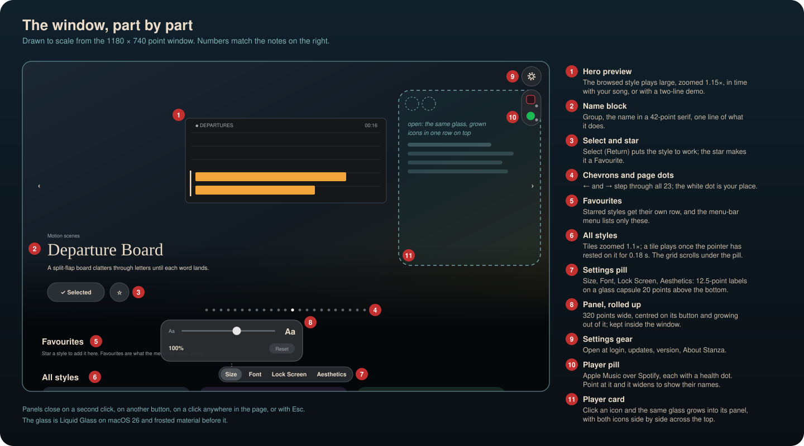
</p>

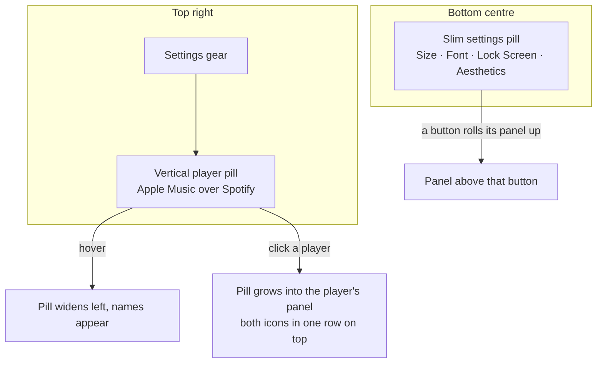

- **The settings pill** (`GallerySettingsBar` in `GalleryView.swift`) floats 20 points above the bottom edge, smaller
  than the old top bar: 12.5-point labels in a 30-point capsule of Liquid Glass. Each button reports where it is
  through an anchor preference, so its panel opens directly above it, centred on the button and kept inside the
  window (`GalleryPanel.left(centredOn:inWindow:)`, covered by the self-check). The panel scales up from the button's
  position on its lower edge, so it reads as rolling out of the button rather than dropping from a corner.
  *Why:* settings belong to the thing being previewed, not to the window frame; a floating bar like a dock keeps them
  in reach without covering the style, and a panel that grows out of its own button shows where it came from.
- **The player pill** (`PlayerDock` in `PlayerPanel.swift`) is one glass shell. Pointed at, it widens to the left just
  enough to show "Apple Music" and "Spotify" beside the icons. Clicked, the same shell grows into that player's card:
  its size and corner radius change, and the two buttons stay in one column whose frame shrinks to a row, with each
  later icon offset up beside the first. Since 0.4.4 that move is an interpolated offset on the same spring as the
  shell (response 0.5, damping 0.82), never a change of layout, so the other player's icon glides into place; the
  panel follows 0.1 s later. It is done with one shell rather than two views cross-fading, so the glass never
  doubles. Its hover state lives in `GalleryHover` and resets when the open player changes.
  *Why:* the players are status as much as controls (each icon carries its health dot), so they stay small and quiet
  until they are needed, and the card unfolding from the pill keeps the link between the icon and its settings.
- **Reduce Motion:** panels fade in place instead of rolling, and the pill and its card cross-fade.

## Colours from the album cover

`ArtworkColorSync` (`Sources/ArtworkColorSync.swift`) only fetches artwork when something uses it: **Colours from
the album cover** is on, or the style is Money or Notifications. Apple Music hands the image over directly through
AppleScript; Spotify gives an address, which is fetched only if it is `https` (URLSession would otherwise read
`file:` addresses). `AccentExtractor` shrinks the image to 40 by 40, buckets its colours, and keeps vivid, distinct
hues: one accent for the three lyric colours (lifted so they stay readable on any wallpaper, and never saved) and a
palette of three to five colours for the cards. A result that arrives after the track changed is ignored.

## Updates and releases

**In the app.** `AppUpdater` (`Sources/AppUpdater.swift`) wraps Sparkle's standard controller. It checks once a
day, downloads an update quietly and installs it when Stanza quits. A downloaded update is offered as **Restart to
Update** in the menu and the window; a background check never throws a window in front of other work. Sparkle reads
the feed at `SUFeedURL` (the `appcast.xml` attached to the latest GitHub release) and only installs an update whose
EdDSA signature matches `SUPublicEDKey` in `Info.plist`. The updater is started only by a normal launch, so the
command-line tools never go online.

**Making a release** (`scripts/release.sh`):

<p align="center">
  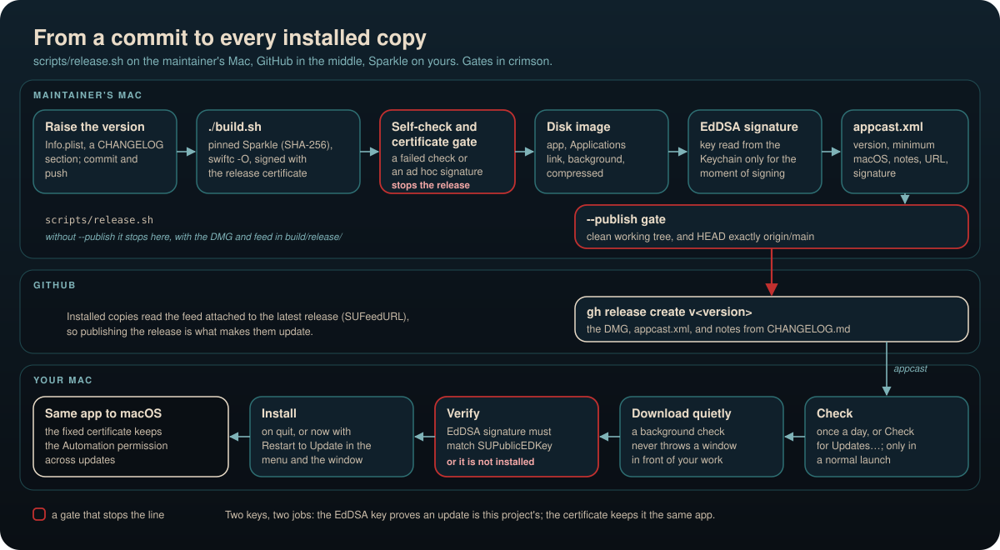
</p>

Step by step:

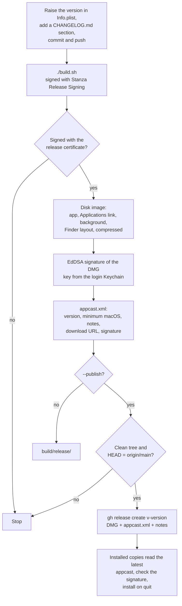

Details worth knowing:

- The release notes are the version's section of `CHANGELOG.md`, used in the GitHub release and the update window.
- The private update key is exported from the Keychain into a private temporary file only for the moment of
  signing, then overwritten and removed; a trap cleans up the key, the staging folder and any mounted image however
  the script ends.
- Publishing refuses unless the working tree is clean and `HEAD` is exactly what is on GitHub, so the disk image
  always matches a pushed commit.

**Two keys, two jobs.**

| Key | What it protects | Where it lives |
|---|---|---|
| EdDSA update key | Installed copies accept only updates signed with it. | Maintainer's login Keychain; public half is `SUPublicEDKey` in `Info.plist` |
| "Stanza Release Signing" certificate | Gives every release the same code identity, so macOS remembers the Automation permission across updates. | Maintainer's login Keychain, as a code-signing identity |

Neither is an Apple Developer ID, so releases are **not notarised**, and macOS asks once to allow the app (see the
README). `build.sh` signs with the certificate when it is present and ad hoc otherwise; `release.sh` refuses to
publish an ad hoc build.

## Open at login

`LoginItem` (`Sources/LoginItem.swift`) uses `SMAppService.mainApp`, the system's own list of login items. It is only
offered for a copy in an Applications folder, because a login item pointing at a copy on the disk image or in
Downloads would break when that copy goes away. If macOS needs the user to approve it, the Settings panel says so.

A login start is quiet. `LoginItem.launchedAtLogin` reads the open-app Apple event of the launch, which macOS marks
as a login-item launch, and `AppDelegate` then skips opening the window: Stanza starts in the menu bar only, as an
accessory app with no Dock icon, until the window is asked for. Opening Stanza any other way shows the window.

## Keyboard shortcuts

`GlobalShortcuts` (`Sources/GlobalShortcuts.swift`) registers the shortcuts recorded in Settings with Carbon's
`RegisterEventHotKey`. It works while another app is in front, needs no Accessibility permission, and the app sees only
its own key combinations, never other typing. Each shortcut is stored as `shortcut.<action>` in the user defaults: the
key code, the Carbon modifiers and the label shown in Settings. No key means no shortcut, which is the default.

Recording uses a local key monitor while the Settings row waits, with every shortcut unregistered meanwhile. A
combination needs two of ⌃ ⌥ ⌘: one ⌘ or ⌃ would take ⌘V or ⌃A away from every app, macOS 15 blocked shortcuts that
use only ⌥ and ⇧, and a bare key would fire while typing. Recording ends if Stanza stops being the active app, and it
only takes keys typed into the window that started it.
The same keys cannot be set for two actions, and a combination the system refuses is shown as taken. **Show or hide
the lyrics** toggles `showWhenUnlocked`, the same switch as the menu and the Lock Screen panel, so there is no second
hidden state. **Next style** follows `AppSettings.nextStyle`: the Favourites in gallery order, or with none, every
style in the menu's order.

## Data and settings

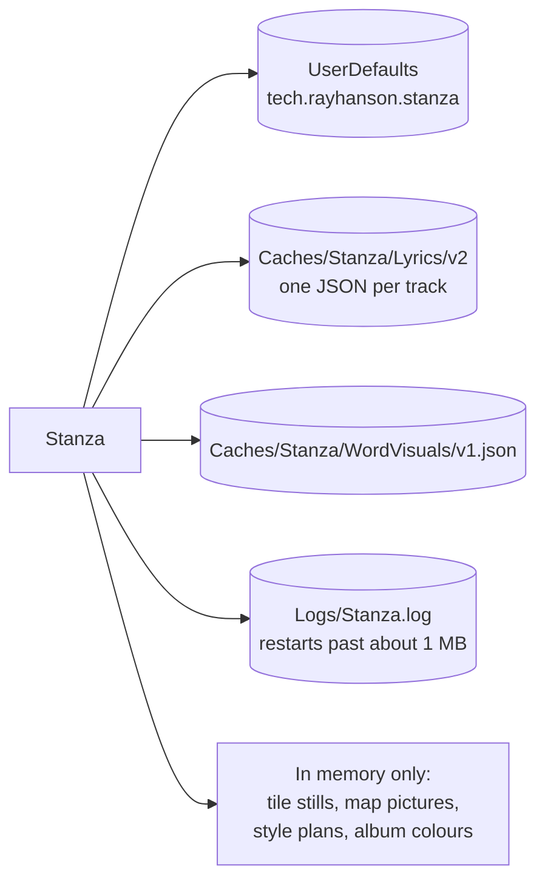

| Where | What |
|---|---|
| `UserDefaults` (`tech.rayhanson.stanza`) | Style, font, Size, standing offset, the three colours (as hex), album-cover colours on or off, Keep Screen Awake, Show When Unlocked, displays turned off, Map 3D and full display, Favourites, the Drag Position offset, first run done, the window's frame, and Sparkle's own update settings. |
| `~/Library/Caches/Stanza/Lyrics/v2/` | Found lyrics, one file per track. Safe to delete. |
| `~/Library/Caches/Stanza/WordVisuals/v1.json` | Words already matched to pictures. Safe to delete. |
| `~/Library/Logs/Stanza.log` | A plain-text log, including each track played and display names. Starts over past about 1 MB. |

The per-song nudge, the album-cover colours, the tile stills and all map pictures are never written to disk.

## Building and checking

`build.sh`:

1. Downloads the pinned Sparkle release into `Vendor/` (not committed) the first time, and checks its SHA-256.
2. Compiles every file in `Sources/` in one `swiftc -O` call, for `arm64-apple-macosx15.0`, linking Sparkle.
3. Assembles `build/Stanza.app` with `Info.plist`, the icon, the menu-bar mark and the framework.
4. Signs it with the release certificate if present, otherwise ad hoc, and verifies the signature.
5. Runs `Stanza --self-check`.

The self-check (`SelfCheck.swift`, `GallerySelfCheck.swift` and checks inside several styles) is a set of
assert-style tests of the pure logic: parsing, matching, timing, the timeline, duets, colours, word pictures, script
detection, the menu's style groups, gap dimming, the moved-lyrics clamp, and layout rules of Web, Messages,
Notifications, Map, Money, Calendar and Voice Memo. There are no UI tests.

GitHub Actions (`.github/workflows/build.yml`) runs `./build.sh` on a macOS 26 runner for every push to `main` and
every pull request, so a change that breaks the build or the self-check shows a red cross on GitHub. It has only read
access to the repository and publishes nothing; releases are still made by `scripts/release.sh`.

## Key design decisions

These are the engineering decisions; the visual and interaction ones are in [DESIGN.md](DESIGN.md).

**Styles are pure functions of `StyleContext`.** A style gets everything it needs in one value and returns a view.
It keeps no state, so the same moment always looks the same. That one rule is why the overlay, the large preview,
the tiles and `--render` agree exactly; why seeking, pausing and replaying need no special handling; and why pictures
in this repository can be produced on the command line. Variety comes from `seededUnit`, a hash of a word's start
time, never from a random number generator.

**No SwiftUI macros, because it builds without Xcode.** The whole app compiles with `swiftc` and the Command Line
Tools, so anyone can build it with `xcode-select --install`. SwiftUI's macro-based features need Xcode's plug-ins,
so views keep no `@State`: animations are computed from time (a word's age, the clock) instead of stored. The same
limit rules out Metal shaders, so effects like a true lens or directional motion blur are approximated, and the code
marks those shortcuts.

**Size balanced by measured footprints.** Some styles are large by nature (the Map, at 0.69, or Ship, at 0.75) and some small (Stretch, scaled up to
1.2). Each style's footprint was measured from `--render` frames so that all of them fill about the same box at
Size 100%. Size then means the same thing for every style, and switching style does not make the lyrics jump in
size.

**Sliding windows while dragging.** Redrawing a style for every mouse movement could not keep up and made the lyrics
stutter behind the pill. Moving a window is free, so during a drag the windows move and the style is not redrawn;
the position is saved once on release.

**A private space for the lock screen.** No public API draws over the lock screen. Stanza uses an undocumented
window-server interface, looks every symbol up at run time, and degrades to "unlocked only" if anything is missing,
rather than crashing or refusing to run.

**A certificate and an EdDSA key.** Without a paid Apple Developer ID, two things still need guaranteeing: that an
update really comes from this project (the EdDSA key that Sparkle checks), and that macOS treats each update as the
same app, so it keeps the Automation permission (a fixed self-signed code-signing certificate). Each key does one of
those jobs.

**Two sources, each for what it does best.** NetEase is asked first because it can give word timing; LRCLIB is the
fallback, and the place Stanza looks for versions in English letters. Matching demands title, artist and length to agree, because a wrong song's
lyrics are worse than none.

**Nothing runs that nobody can see.** The overlay's timeline pauses without lyrics, without music, or where the
window is in use; the window pauses when hidden, covered or locked; the player panels poll only while shown; and
artwork is fetched only when a setting or style uses it.

## Source map

| Area | Files |
|---|---|
| Entry and tools | `main.swift`, `Diagnostics.swift`, `GalleryDiagnostics.swift`, `Log.swift` |
| App and menu | `AppDelegate.swift`, `AppSettings.swift`, `SystemState.swift`, `LoginItem.swift`, `GlobalShortcuts.swift`, `ShortcutViews.swift` |
| Players | `NowPlayingMonitor.swift`, `PlayerLink.swift`, `PlayerSteps.swift` |
| Lyrics | `LyricsProvider.swift`, `LyricsParsing.swift`, `Model.swift`, `LyricEngine.swift` |
| Overlay | `OverlayView.swift`, `OverlayWindows.swift`, `LyricPlacement.swift`, `SizeSlider.swift`, `ScrollAdjust.swift` |
| Styles | `WordStackStyle.swift`, `*Style.swift`, `MoneyFeed.swift`, `MoneyPlan.swift`, `MoneyMapPictures.swift`, `NotificationsFeed.swift`, `NotificationsPlan.swift`, `MapTour.swift`, `WordVisuals.swift` |
| Colours | `ArtworkColorSync.swift` |
| Window | `Gallery*.swift`, `StyleDemo.swift`, `StyleStills.swift`, `StyleBackdrop.swift`, `PlayerPanel.swift`, `OnboardingView.swift`, `UpdateViews.swift`, `AboutViews.swift` |
| Updates | `AppUpdater.swift`, `scripts/release.sh`, `Info.plist` |
| Checks | `SelfCheck.swift`, `GallerySelfCheck.swift` |
