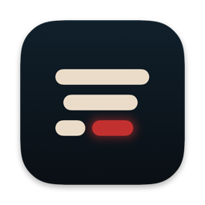
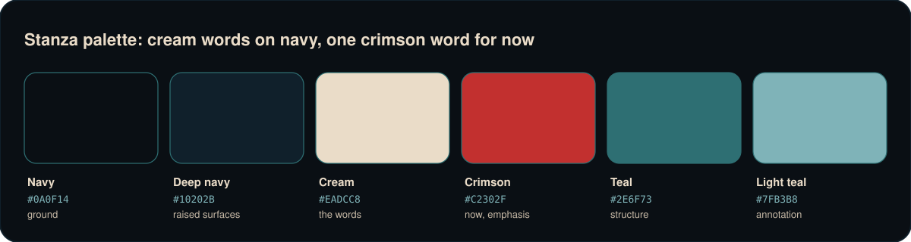
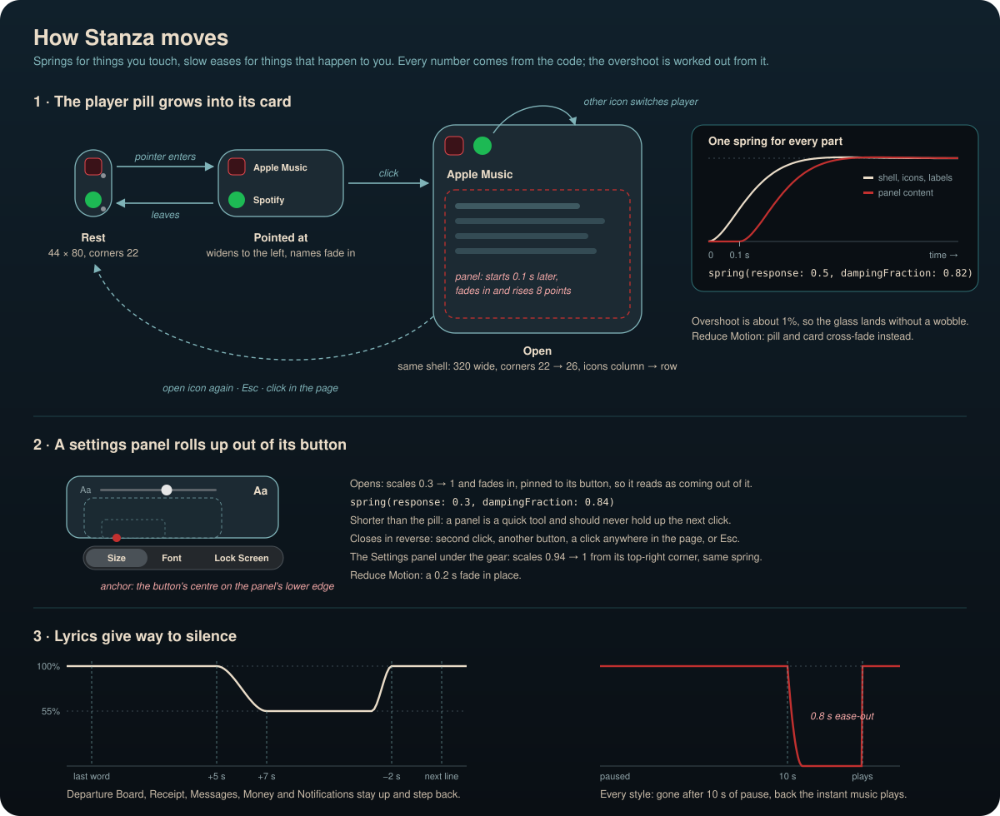
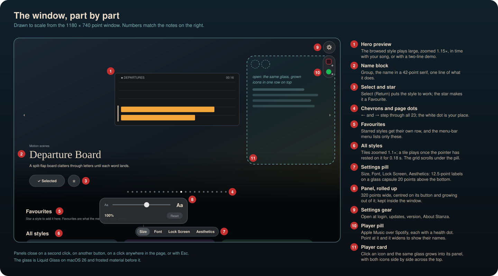
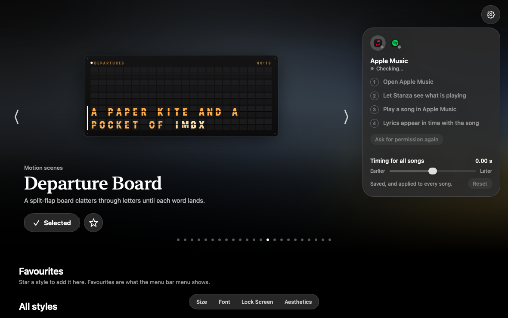
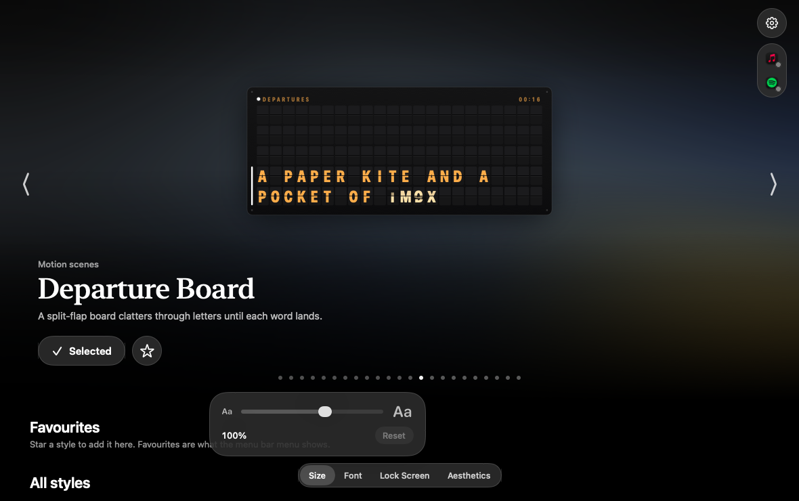

  

<h1 align="center">How Stanza is designed</h1>

The reasoning behind every look and every movement, with the numbers from the code.

  <a href="../README.md">README</a> |
  <a href="ARCHITECTURE.md">Architecture</a> |
  <a href="STYLES.md">Styles</a> |
  <a href="#principles">Principles</a> |
  <a href="#visual-language">Visual language</a> |
  <a href="#motion-system">Motion</a> |
  <a href="#interaction-design">Interaction</a> |
  <a href="#accessibility">Accessibility</a> |
  <a href="#the-styles-in-design-terms">The styles</a>

Stanza puts the words of a song on top of whatever is on screen, in time with the music. That one job sets every
design problem the app has: the words must be readable over any wallpaper, they must land exactly when they are
sung, they must never fight the user for attention, and the controls around them must stay out of the way until
they are wanted. This page explains how each part answers those problems and which design principle it leans on.
Every claim points at the code (`Sources/`) so it can be checked; [ARCHITECTURE.md](ARCHITECTURE.md) covers how the
same parts are built, and [STYLES.md](STYLES.md) goes through the 23 styles one by one.

## Contents

- [Principles](#principles)
- [Visual language](#visual-language)
- [Motion system](#motion-system)
- [Interaction design](#interaction-design)
- [Accessibility](#accessibility)
- [The styles in design terms](#the-styles-in-design-terms)

---

## Principles

Eight ideas run through the whole app. Each one is named after the design principle it applies.

### 1. The words are the figure (figure and ground)

The overlay has no background of its own: it is a transparent window over a white document, a photo, a black lock
screen. Readability cannot rely on what is behind it, so every style makes its own ground. Either the text carries
a soft dark shadow (Ship, Stretch, Ink, Liquid, Codestyle and others), or the style brings an opaque surface that
it controls completely: a split-flap board, a till roll, a printed card, a phone panel. This is figure-ground
separation by construction rather than by luck.

The same rule governs colour. When **Colours from the album cover** is on, the accent is not used raw.
`AppSettings.applyAccent` lifts the highlight to at least 75% brightness and caps the text colour's saturation at
45% at full brightness, with the secondary colour at 70% opacity, because a dark or muddy cover colour would sink
into a dark wallpaper. Some cover colours are never picked as an
accent at all: colours too grey, or with brightness under 0.3, are skipped (`AccentExtractor` in
`ArtworkColorSync.swift`).

### 2. Time is the grid (rhythm)

In print, a grid decides where things go. In Stanza, the song's timing does. Every style is a mapping from time to
form: a word appears when it is sung, and how long it is held decides how big it is (Ship), how long its note is
(Score), how wide it stretches (Stretch), how slowly the pen writes it (Ink) or how tall its event is (Calendar).

Two small numbers make that mapping feel right. The song clock runs **0.18 s ahead** of the player
(`Timing.displayLead` in `Model.swift`), so a word lands as it is heard rather than a beat after, since what the
eye sees and the ear hears are judged together. And a line lingers **0.8 s** after its last word
(`Timing.lineLinger`), long enough to finish reading, short enough that a gap reads as a gap.

### 3. The same moment always looks the same (determinism)

A style is a pure function of a `StyleContext` value: the line, the position, the clock, the canvas, the settings
(`OverlayView.swift`). Nothing is remembered between frames. Where a style wants variety (a tilt, a side, a
typeface, a colour), it calls `seededUnit(seed, salt:)`, a SplitMix64 hash of the word's start time, never a random
number generator. A word therefore keeps its tilt, its scrap of magazine or its branch for as long as it is on
screen, on every replay and in every picture.

This is visual stability as a design value: nothing flickers, nothing reshuffles when you seek, and the window's
previews, the tiles and `--render` show exactly what the overlay shows. It also has a practical root: the app builds
with the Command Line Tools alone, without the SwiftUI macros that `@State` needs, so animation is computed from
time instead of stored.

### 4. Things come from somewhere (spatial continuity)

When something appears, it grows out of the thing that caused it. A settings panel rolls up out of its own button;
the player pill grows into the player's card; a Messages bubble grows out of its typing indicator; a Money item grows
out of its lead pill. The eye never has to search for where a new thing came from, because it watched it arrive.
This is object permanence applied to an interface: the pill and the card are visibly *the same object*, one glass
shell that changes shape (`PlayerDock` in `PlayerPanel.swift`), not two views swapping.

### 5. Quiet until needed (progressive disclosure)

The window gives the whole top of the frame to the preview. The four lyric settings sit in one slim pill at the
bottom; the two players sit in a narrow vertical pill under the gear and show their names only when pointed at;
each panel appears only when asked for and one at a time. The menu-bar menu lists only your Favourites once you have
some, so it stays short however many styles there are. Each layer of detail is one gesture away, and none of it is
on screen by default.

### 6. The same Size means the same size (normalisation)

Styles differ wildly in natural size: a city map against three stacked words. Each style has a measured
`footprint` (`LyricStyle.footprint` in `OverlayView.swift`) chosen so that at Size 100% every style fills about the
same box, half the screen wide and 45% tall. The Map is drawn at 0.69 and Ship at 0.75 because they are large by
nature; Stretch is scaled up to 1.2 because it is small. Styles draw at `context.scale`, Size times footprint, never
at Size directly. Switching style therefore never makes the lyrics jump in size, and the Size slider means the same
thing everywhere: consistency as a contract with the user.

### 7. Motion carries meaning; decoration is optional (Reduce Motion)

Stanza separates movement that tells you something (a word arriving, a held note stretching, the marker reaching a
word) from movement that is only there to delight (a pop, a sway, a nib). With macOS **Reduce Motion** on, the
window's large preview holds a still frame, panels fade in place instead of rolling, the pill and card cross-fade,
and 14 of the 23 styles drop their decorative motion while keeping the motion that carries timing. The
[table in STYLES.md](STYLES.md#at-a-glance) shows exactly which.

### 8. Nothing runs that nobody can see (calm technology)

A lyrics app runs for hours in the background, so restraint is part of the design. The overlay's `TimelineView` is
paused with no lyrics, no music, on the display where the window is in use, and after 5 s of pause (when the
overlay also fades away). The window pauses when hidden, covered or locked; tiles fall back to still pictures while
the page scrolls (`GalleryModel.tilesStillOnly`); the player panels poll only while shown. Calm is also visual:
long instrumental gaps dim the styles that stay on screen instead of leaving them shouting.

---

## Visual language

### Liquid Glass

Every piece of window chrome (the settings pill, the gear, the player pill and card, the panels) is one material:
`GlassSurface` in `GalleryChrome.swift`. On macOS 26 it is Liquid Glass (`glassEffect(Glass.regular)`); before that
it is the system's ultra-thin material with a 14% white hairline. The Drag Position pill, an AppKit panel, matches it
with `NSGlassEffectView` on macOS 26 and a dark frosted pill before (`LyricPlacement.swift`). The
pictures in this repository are rendered offscreen, where glass cannot sample what is behind it, so they show the
flat fallback (20% grey at 86% opacity with the same hairline).

*Why glass:* the chrome floats above the preview rather than framing it. Glass keeps the preview visible through
the controls, so the content stays the figure and the controls read as a layer in front of it, with depth instead of
borders. One material for every control also makes them read as a family (Gestalt similarity): anything glass can be
touched.

### Colour

Stanza's identity palette is used for the logo, the banner, the disk image and these pages:

  

| Name | Hex | Role |
|---|---|---|
| Navy | `#0A0F14` | ground |
| Deep navy | `#10202B` | raised surfaces |
| Cream | `#EADCC8` | the words |
| Crimson | `#C2302F` | the word being sung; emphasis |
| Teal | `#2E6F73` | structure |
| Light teal | `#7FB3B8` | secondary text, annotation |

The logo, Quatrain, is the palette's argument in miniature: three cream lines on navy, the last word lit crimson.
Cream on navy is the reading state; one crimson word is "now".

Inside the app the palette steps back for the user's own. The lyric colours default to white text and highlight,
with the secondary colour at 70% white (`ColorSlot.defaultColor`), the most neutral choice over unknown wallpapers.
The window gives each style a mood instead: `StyleBackdrop` paints a soft 3 × 3 mesh gradient from four colours
chosen for that style (deep navy and amber for Ship, warm paper tones for Score, a terminal's near-black and red for
Codestyle), with dark corners and the accent low on the right. A gradient over the top of the hero darkens it to
34% at the top and to 70% at the foot, so the title and buttons always sit on a dark enough ground to read.

### Type

- **The style's name** is set in the system serif (New York) at 42 points, medium weight: a quiet editorial voice for
  the one thing on the page that is a title, set against the sans-serif controls.
- **Controls** use SF Pro at 12.5 points medium in the pills, 13.5 points for tile names and 15 points semibold on the
  large capsule buttons, so the hierarchy is carried by size and weight within one family.
- **Lyrics** use one of seven fonts you choose (SF Pro, SF Rounded, New York, Helvetica Neue, Avenir Next, Futura,
  Didot). Some styles bring their own type because the type *is* the style: Codestyle's monospace, Departure Board's
  condensed capitals, Ransom Note's fourteen magazine faces, the phone screens' system font, Highlighter's serif.

### Shape

- Controls are capsules: 30-point buttons in the settings pill, 44-point capsules for Select and the star. A capsule
  reads as pressable; a rectangle reads as content.
- Tiles and the preview frame use continuous corners (radius 20 on tiles), matching the system's own shapes.
- Panels are 320 points wide wherever they open, so the eye learns one width.
- The player pill uses *circular* corners in both states, on purpose: continuous corners cannot form a true capsule,
  and switching corner style mid-morph would make the pill's ends jump. Only the radius changes, from 22 to 26
  (`PlayerDock.Metrics`).

---

## Motion system

  

### Springs for touch, eases for time

Stanza uses two families of motion, and the split is deliberate.

- **Springs** for anything the user touches: the pill, the panels, a word picture landing. A spring has no fixed
  duration; it has a stiffness (`response`) and a damping. It takes interruption gracefully: a spring retargets
  from wherever it is, with the speed it already has, so the pill clicked shut halfway through opening simply turns
  round. That is why direct manipulation feels physical.
- **Eases** for things that happen *to* the user, on the song's clock or after a wait: the hero's cross-fade between
  styles, the overlay fading after a pause, lines dimming in a gap. These have a known length and should feel like
  weather, not like a reaction.

### The vocabulary

| What moves | Curve | Values (from the code) | Why |
|---|---|---|---|
| Player pill → card | spring | response 0.5, damping 0.82; shell, corners, icons and labels together | One curve for every part keeps the object whole; 0.82 damping overshoots about 1%, so glass lands without a wobble. |
| Card content | same spring, delayed | starts 0.1 s later, fades in and rises 8 points | The icons' move reads first, then the panel: staggered timing makes the cause visible before the effect. |
| Settings pill panels | spring | response 0.3, damping 0.84; scale 0.3 → 1 with opacity, anchored on the button | Shorter than the pill, because a panel is a quick tool; anchored, so it rolls out of its button. |
| Settings (gear) panel | spring | same; scale 0.94 → 1 from its top-right corner | A small scale for a panel that opens near its corner: present, not theatrical. |
| Reduce Motion, panels | ease in-out | 0.2 s fade in place | Same information, no travel. |
| Hero, style change | ease in-out | 0.4 s cross-fade of backdrop and preview | A change of subject, not a movement: it fades rather than slides. |
| Tile clicked | ease in-out | 0.45 s scroll back to the hero | Takes you to where the chosen style now plays. |
| Tile hover | ease-out | star 0.15 s; browsed ring 0.2 s; live preview 0.25 s, after the pointer rests 0.18 s | The delay stops tiles flashing to life as the pointer crosses the grid; it plays only when you mean it. |
| Button press | ease-out | 0.12 s | Instant enough to feel like a key. |
| Word pictures | spring | emoji: response 0.3, damping 0.25, swinging in from −14°; symbols: the system wiggle at 1.5× | Low damping gives a playful bounce to a decoration that should feel alive. |
| Sway (Ship, Visual) | sine of the clock | yaw 16°, pitch 7°, scale 3.5%, at 0.35, 0.22 and 0.17 radians a second | Three unrelated slow periods never visibly repeat; words keep their places relative to each other, so it reads as depth, not shake. |
| Gaps (stay-on styles) | smoothstep | after 5 s of quiet, dim by 0.45 over 2 s; wake between 2.8 and 2 s before the next line; after the last line, fade out from 4 s to 6.5 s | Steps back instead of vanishing, and is fully awake before the singer returns. |
| Pause | ease-out | after 5 s of pause, fade to nothing over 0.8 s; back instantly on play | Patient to leave, eager to return: music coming back should never wait for an animation. |

Sources: `PlayerPanel.swift` (`PlayerDock.motion`, `contentDelay`), `GalleryView.swift`, `GalleryHero.swift`,
`GalleryShelf.swift`, `GalleryChrome.swift`, `OverlayView.swift` (`Layout`, `GapDimming`, `WordIcon`),
`AppDelegate.swift` (`idleDelay`).

### The pill morph, frame by frame

The player pill is the most deliberate piece of motion in the window.

1. **At rest** it is a 44 × 80 glass capsule: Apple Music above Spotify, each icon with a health dot.
2. **Pointed at**, it widens to the left just enough for the names to fade in beside the icons. The width change and
   the fade share the spring, so the label never appears before there is room for it.
3. **Clicked**, the same shell grows to the 320-point card and its corner radius eases from 22 to 26. The two icons
   do not re-layout; they are always the same column, and in the card each later icon is *offset* up beside the
   first, so the change from column to row is an interpolated position on the same spring rather than a jump to a
   new layout. The panel content follows 0.1 s later. A clip to the shell keeps the content inside the glass while it
   grows, so the glass never doubles up.
4. **Closing** reverses it. Clicking the other icon switches player inside the card. Whenever the open player
   changes, the pill's hover state resets (`GalleryModel.menu`), so it comes back as a plain pill, not a labelled one.

This is spatial continuity carried to its end: you never see a pill disappear and a card appear, only one object
changing shape.

### The roll-up panel

Each button in the settings pill reports its own frame through an anchor preference (`MenuButtonBounds`). The panel
is placed centred over that button and kept inside the window (`GalleryPanel.left(centredOn:inWindow:)`, covered by
the self-check), and its scale anchor is the button's centre on the panel's lower edge. The panel therefore grows
*out of the button*, like a sheet rolling up out of a slot. Placing it with alignment guides rather than an offset
keeps the view's bounds the card's own, so the anchor stays on the button even as the window resizes.

### Lyrics in silence

A song is not continuous text. Three behaviours, chosen per style, handle the silences
([STYLES.md](STYLES.md#what-every-style-shares) has the full list):

- **Clear.** Most styles are gone 0.8 s after a line ends. The screen is empty when the singer is.
- **Step back.** Departure Board, Receipt, Messages, Money and Notifications stay up and dim to 55% after 5 s of
  quiet (`StyleContext.gapPresence`), then wake 2 s before the next line, so they are fully back when it starts.
  Smoothstep ramps mean there is never a visible cut.
- **Show what is coming.** Map, Calendar and Voice Memo stay at full strength and tell you what is next instead: the
  next leg announced, a "Free until…" chip, the next take waiting.

And whatever the style, the overlay fades away after 5 s of pause and is back the moment music plays.

### Dragging without lag

Drag Position moves the lyrics with a small glass pill. Redrawing a style for every mouse movement could not keep up
and the words trailed behind. So during a drag, nothing is redrawn: every overlay window *slides* by the same share
of its display (`OverlayController.slide(by:)`), which costs the window server almost nothing. On release the offset
is saved once and the windows are put back in the same Core Animation transaction, with the lyrics already redrawn
at their new spot, so nothing jumps. The design lesson: perceived responsiveness can matter more than doing the
"real" work on every frame.

---

## Interaction design

  

### The window: one hero, one shelf

The window is a stage and a shelf. The hero plays the style you are browsing, large (zoomed 1.15×, `StyleStage.heroZoom`),
with its group, name, one-line description, **Select** and a star. Below it, Favourites and then every style as tiles
(zoomed 1.1×). The hierarchy is unambiguous: one thing is big and moving, everything else is small and still until
you rest the pointer on it.

<table>
  <tr>
    <td width="50%"></td>
    <td width="50%"></td>
  </tr>
  <tr>
    <td align="center">The Apple Music card, grown from the player pill. The preview makes room for it.</td>
    <td align="center">The Size panel, rolled up out of its button.</td>
  </tr>
</table>

- **Browsing is cheap, choosing is explicit.** The arrows, ← and →, the page dots and a click on a tile all *browse*;
  only **Select** (or Return) changes what the overlay uses. You can look at all 23 without changing anything, which
  makes exploring safe.
- **Recognition over recall.** You choose a style by watching it, with your own song if one is playing, not by reading
  its name. The tiles are real frames of each style, not illustrations.
- **Panels make room.** When the player card opens, the hero's stage narrows so the card never covers the preview
  (`GalleryHeroStage`: the width shrinks by the panel's inset).

### Favourites

A star on the hero and on each tile (shown on hover, or always once starred) adds a style to **Favourites**. Starred
styles get their own row above All styles, and the menu-bar menu then lists only them plus the style in use. This is
progressive disclosure driven by the user: the menu starts complete and becomes personal, rather than asking anyone to
configure it. The data model is kept honest too: Favourites are saved under the older "pinnedStyles" key, so
everything pinned before 0.4.1 carried over without a migration step.

### The settings pill and its panels

The four lyric settings (Size, Font, Lock Screen, Aesthetics) belong to the thing being previewed, not to the window
frame, so they float over the page like a dock, 20 points above the bottom edge. The labels are words, not icons:
"Lock Screen" says more than any glyph would. Each panel opens over its own button (proximity: the control and its
result are together), one at a time. Closing is forgiving: click the button again, click another one, click anywhere
in the page, or press Esc. A click on the page still does its own job as well (`simultaneousGesture`), so dismissing a
panel never costs a click.

### The player pill and card

The players are status as much as controls: each icon carries a health dot. So they stay small, under the gear, and
reveal their names only when pointed at. A click grows the pill into that player's card, where the connection is
shown as numbered steps (player open, permission, playing, lyrics found) with one button for the step that is still
open. Numbered steps turn a confusing permissions problem into a short checklist with a visible next action.

### The Settings gear

Settings that belong to the app rather than to the lyrics (Open at login, keyboard shortcuts, Install updates automatically, the version
with **Check Now**, and **About Stanza**) live behind a single gear at the top right, the place a Mac user already
looks for them. Keeping them apart from the lyric settings at the bottom separates "how the words look" from "how the
app behaves", so neither panel is cluttered by the other. Its panel opens from the gear's corner (scale 0.94 on the
same spring as the other panels) and, like the player card, narrows the hero so the preview stays in view. Updates
follow the same "quiet until needed" rule: only when one is waiting does a glass pill appear at the top left of the
window ("Restart to update", `UpdatePill` in `UpdateViews.swift`) and the menu item turn into **Restart to Update**. Open at
login keeps the same rule: a login start brings only the menu bar icon, because a window jumping up while the Mac
is still starting is noise, not help. Stanza is already working by then; the window is there when it is asked for. Keyboard shortcuts follow it too: none are set until you record one, because a
shortcut nobody chose can clash with another app's or fire by surprise, and the lyrics' own switches stay the only
state, so a shortcut never leaves the menu and the window disagreeing. What's New is the one thing that opens unasked, and
only once per update, inside the window and only when you open it: an update that changes the app without saying
how is worse than one short card. Because it comes once, it is allowed to be seen: it pops up in the middle of the
window over a dimmed page, on an underdamped spring (response 0.55, damping 0.55) that overshoots by about a tenth
and settles back, and it waits for OK. A first try as a corner panel proved easy to miss.
The one moment the app needs something from you is the one moment it shows.

### The menu bar

The menu is built for a glance and a click: Open Stanza, your Favourites, the two visibility switches, Position and
Size, Displays, updates and Quit. Its Styles and Displays sections are rebuilt each time it opens (`menuNeedsUpdate`),
so they always match the current Favourites and the connected displays. With no Favourites it groups every style as
Kinetic type, Motion scenes and Phone screens, so a long list still has structure.

### Drag Position

Placing lyrics is direct manipulation: a slim glass pill appears where the lyrics sit, you drag it, and the lyrics
stay glued to it, even past the edge of the screen. The pill also holds the Size slider, so position and size are set
in one place, and a round Done button. It lives in the lyrics' own lock-screen space, one level above them, because
that is the only way anything can be in front of them.

### Sliders that always answer

Every Size slider (menu, pill, window) and the Timing slider:

- **take the first click** even when Stanza is not the active app, which a standard slider in a menu does not
  (`SizeSlider`);
- **throttle** while dragging, passing a change on at most every 0.05 s because each change redraws every visible
  style, and always sending the exact value on release;
- **follow the scroll wheel and a two-finger swipe** (`ScrollAdjust`): a 400-point swipe or 40 wheel notches cross the
  whole range, and the system's natural-scrolling flip is undone so that a physical move *up* always means bigger.
  That is natural mapping: the hand's direction, not a preference, decides.

### Keyboard

← and → browse, Return selects (only while the hero is on screen, so Return never acts on something you cannot see),
Esc closes a panel, and the usual ⌘Q, ⌘H, ⌘W and ⌘M work while the window is open.

### First run

A short introduction walks through the player, the permission and the choice of style, with the hero already
playing. It starts 1.3 s into the demo, part-way through a line, so there are words on screen at once.

---

## Accessibility

- **Reduce Motion** is honoured in the window (still hero, fading panels, cross-faded pill and card) and in 14 of the
  23 styles. The nine kinetic and motion styles that keep their motion (Ship, Fisheye, Visual, Fisheye Visual,
  Codestyle, Codestyle Visual, Branches, Web, Constellation) are listed in the
  [table in STYLES.md](STYLES.md#at-a-glance); bringing them in line is open work.
- **Readable over anything.** Shadows or opaque surfaces on every style, and lifted album-cover colours (see
  [principle 1](#1-the-words-are-the-figure-figure-and-ground)).
- **VoiceOver labels and traits** on the window's controls: each player icon is read with its state
  ("Apple Music, …"), each tile with its name and group and its one-line summary as a hint, and selected states
  (the browsed dot, the open panel's button, a starred style) carry the selected trait. The moving hero is hidden
  from VoiceOver, since its content is the style named right below it.
- **Keyboard** for browsing, selecting and closing panels.
- **No surprise permissions.** Stanza asks for Automation only, and only when a player is first read. It never needs
  the microphone, location, screen recording or accessibility access; Voice Memo's waveform, for example, is drawn
  from word timing, not from audio.

This list describes what the code does; it has not been through a formal accessibility audit.

---

## The styles in design terms

Each style is a small design argument. The full reasoning, with how each is built, is in [STYLES.md](STYLES.md).

The three groups lean on different kinds of meaning. **Kinetic type** works with the letters themselves: size, tilt,
stretch, the pen's speed. **Motion scenes** borrow a familiar object (a code editor, a split-flap board, a music
staff, a highlighter, a till) and let its own behaviour carry the timing; this is skeuomorphism with a purpose, since
everyone already knows that a flap that clatters has just changed and that a receipt grows as it prints, so the style
needs no explanation. The **phone screens** go furthest: each lyric line becomes the thing an app on a phone shows (a
message, a payment, an alert, a turn, an event, a recording). They bring their own system type and colours because
the look of the app *is* the metaphor, and they draw the whole song so history can build up the way it does in the
real app. That familiarity is also why they sit so naturally above the lock screen, where a phone-like card is
expected.

| Style | The principle it leans on | Its motion idea |
|---|---|---|
| [Ship](STYLES.md#ship) | Hierarchy by duration: held words are bigger | Springs in from a third of its size; the wall sways in 3D |
| [Fisheye](STYLES.md#fisheye) | Focal point: three words, the middle swollen | Each word pushes the stack up; tipped rows suggest a lens |
| [Visual](STYLES.md#visual) | Dual coding: a word and its picture | Faint backdrop picture cross-fades per word |
| [Fisheye Visual](STYLES.md#fisheye-visual) | Every look is one click | As Fisheye, plus pictures |
| [Stretch](STYLES.md#stretch) | Expressive typography: the vowel is the note | Held letters slide out one every 0.2 s |
| [Ransom Note](STYLES.md#ransom-note) | Contrast between neighbours; collage | Scraps slap down, squash and settle |
| [Ink](STYLES.md#ink) | Duration made visible: a long note is a slow hand | The pen traces each letter over the sung time |
| [Liquid](STYLES.md#liquid) | Continuity: each word flows from the last | Metaball goo that firms into crisp text |
| [Codestyle](STYLES.md#codestyle) | Familiar metaphor: a cursor is "you are here" | Glyph-by-glyph typing; a punch per row |
| [Codestyle Visual](STYLES.md#codestyle-visual) | Hint without breaking the shape | One picture per row, outside the text |
| [Branches](STYLES.md#branches) | Continuity: a line grows as the line is sung | Springy branches, planned so nothing reflows |
| [Web](STYLES.md#web) | History made visible; progress in disguise | One silk thread per word; the spider is a progress bar |
| [Constellation](STYLES.md#constellation) | Closure: words join into a figure | Lines grow star to star in sung order |
| [Departure Board](STYLES.md#departure-board) | Skeuomorphism: a machine everyone reads as "this just changed" | Tiles ripple left to right, diffed between states |
| [Score](STYLES.md#score) | Rhythm as notation | Fixed playhead, moving music |
| [Highlighter](STYLES.md#highlighter) | Preview the whole line; mark the place | The marker swipes over each word's sung time |
| [Receipt](STYLES.md#receipt) | A record that grows | Print-head wobble; paper feeds out |
| [Messages](STYLES.md#messages) | Familiar pattern: a pause reads as typing | Bubbles grow from the typing dots |
| [Money](STYLES.md#money) | Big short text suits big bold cards | Items grow from a lead pill; never the same kind twice in a row |
| [Notifications](STYLES.md#notifications) | Native to the lock screen | Banners stack; the glance row counts down |
| [Map](STYLES.md#map) | Progress as distance | One walked leg per line; a pin per line |
| [Calendar](STYLES.md#calendar) | The shape of the whole song at once | A "now" line walks down the day |
| [Voice Memo](STYLES.md#voice-memo) | Transcript under a waveform | The waveform is drawn from word timing |

Made by Harvey Rayhanson · <a href="https://rayhanson.tech">rayhanson.tech</a>

