

  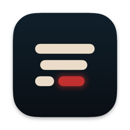

<h1 align="center">The 23 styles</h1>

How each style plays, how it is built, and why it looks the way it does.

  <a href="../README.md">README</a> |
  <a href="ARCHITECTURE.md">Architecture</a> |
  <a href="DESIGN.md">Design</a> |
  <a href="#kinetic-type">Kinetic type</a> |
  <a href="#motion-scenes">Motion scenes</a> |
  <a href="#phone-screens">Phone screens</a>

Stanza draws the words of a song in one of 23 styles, chosen in the window or from the menu-bar menu. This page
covers them in the order the window shows them. Each frame below was drawn by `Stanza --render` with the app's
invented sample lyrics, at Size 100% in SF Pro, and cropped to the lyric band.

Every style has four parts: **how it plays**, **how it's built**, **why it's designed this way**, and a **design
theory** note that names the principles it rests on (figure and ground, hierarchy, continuity, rhythm, metaphor) and
explains its motion. The ideas shared by the whole app are set out in [DESIGN.md](DESIGN.md).

## Contents

| Kinetic type | Motion scenes | Phone screens |
|---|---|---|
| [Ship](#ship) | [Codestyle](#codestyle) | [Messages](#messages) |
| [Fisheye](#fisheye) | [Codestyle Visual](#codestyle-visual) | [Money](#money) |
| [Visual](#visual) | [Branches](#branches) | [Notifications](#notifications) |
| [Fisheye Visual](#fisheye-visual) | [Web](#web) | [Map](#map) |
| [Stretch](#stretch) | [Constellation](#constellation) | [Calendar](#calendar) |
| [Ransom Note](#ransom-note) | [Departure Board](#departure-board) | [Voice Memo](#voice-memo) |
| [Ink](#ink) | [Score](#score) | |
| [Liquid](#liquid) | [Highlighter](#highlighter) | |
| | [Receipt](#receipt) | |

Also on this page: [what every style shares](#what-every-style-shares), [word pictures](#word-pictures) and a
[summary table](#at-a-glance) of fonts, colours, pauses and Reduce Motion.

## What every style shares

**One frame is one function call.** A style is a SwiftUI view built from a `StyleContext`
(`Sources/OverlayView.swift`): the current line and how many of its words have started, the whole song's timed
words, the playback position, a wall clock, the canvas size, the lyric band, the settings and a scale. Nothing in a
style remembers anything between frames. Every entrance, bounce, fade and flip is worked out from the position and
the clock, so the same moment of a song always looks the same. That is what lets the window's previews, the tiles
on the shelf and `--render` draw exactly what the overlay draws.

**No view state.** The project builds with `swiftc` and the Command Line Tools alone, without Xcode, so it uses no
SwiftUI macros; the code notes that `@State` needs full Xcode. So no style keeps state between frames, and nothing is
animated by stored state. Where a style needs "random" variety (a tilt, a
side, a colour), it calls `seededUnit(seed, salt:)`, a SplitMix64 hash of usually a word's start time. A word
gets the same tilt on every frame and every replay, and never flickers.

**One size for all.** Each style has a `footprint`, measured with `--render` so that at Size 100% every style fills
about the same box (half the screen wide, 45% of it tall). Styles scale by `context.scale`, which is Size times the
footprint, and never by Size directly. Branches, Constellation and Score run across the screen by design, so only
their height is matched.

**The band.** Lyrics live in a band 56% of the screen tall whose centre sits 56% of the way down, unless Drag
Position has moved it. `LyricStage` places the style there, applies the slow 3D sway that Ship and Visual use, and
shifts it by the saved offset.

**What happens in a pause.** There are three behaviours:

- **Most styles** draw only while a line is active: from its first word until 0.8 s after its last word ends
  (`Timing.lineLinger`), or until the next line starts. In a longer gap the screen is clear. Some fade out on their
  own inside that window.
- **Departure Board and Receipt** stay up through gaps (`keepsCardBetweenLines`) and dim using
  `StyleContext.gapPresence`: full while a line is sung, down to 55% after 5 s of quiet, awake again 2 s before the
  next line, and gone a few seconds after the last one. These are the timings Messages uses.
- **The six phone screens** are drawn for the whole song (`drawsWholeSong`), before the first line, through every
  gap and after the last line, because they show history. Messages, Money and Notifications dim in long silences
  with the same timings; Map, Calendar and Voice Memo stay at full strength and say what is coming next instead.

Separately, the whole overlay fades away once the music has been paused for 10 seconds, whatever the style.

**Readable over any wallpaper.** The overlay is transparent and sits on top of whatever is behind it, from a white
document to a black lock screen. So every style either carries a soft dark shadow or brings its own opaque surface
(a card, a board, a till roll, a phone panel).

## Word pictures

Visual, Fisheye Visual, Codestyle Visual, Branches, Money and Notifications draw a small SF Symbol or emoji beside
some words. `WordVisuals` (`Sources/WordVisuals.swift`) chooses them, entirely on the Mac:

1. A word is reduced to lowercase letters. Words shorter than three letters, and common or vague words ("going",
   "feel", "keep"), never get a picture.
2. The render loop asks `visual(for:)`, which only does fast lookups: a remembered answer, then a hand-written table
   of symbols, then the keywords macOS ships with its own symbol search, then a small emoji table. Simple stems are
   tried too (`-s`, `-ing`, `-ed`).
3. When a song's lyrics arrive, `prepare(words:)` resolves the misses in the background with Apple's Natural Language
   word embedding: it takes the 20 nearest words in meaning and uses the first that has a picture.
4. Answers are saved to `~/Library/Caches/Stanza/WordVisuals/v1.json`. No network is involved.

In the views, `WordIcon` springs an emoji in from a tilt and gives a symbol the system's wiggle effect. It is driven
by the word's age, not by view state, for the same reason as above.

---

## Kinetic type

Typography that moves: words that stack, swell, stretch, are cut out, written or poured.

## Ship

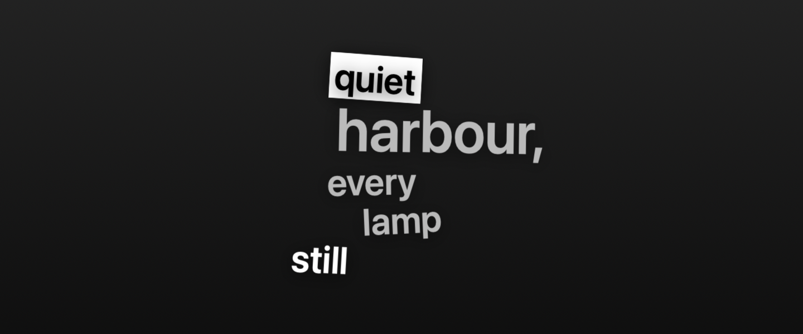

*Every word settles onto a wall that sways slowly in space.*

**How it plays.** The words of the line stack top to bottom like entries in a logbook, newest at the bottom, up to
five rows. Each new word springs in from a third of its size, and older words scroll up and off the top. Every row
starts at its own indent and leans up to 4.5° either way. About one word in five is set as a "pill": dark text on a
solid block of the highlight colour. Long-held words are drawn bigger, up to about one and a half times. The whole
wall drifts slowly in 3D, turning, tipping and breathing in scale. When the line's linger ends, the wall is gone, and
the next line starts a fresh one.

**How it's built.** `WordStackStyle(kind: .ship)` in `Sources/WordStackStyle.swift`, the view shared by the four
stack styles. It is ordinary SwiftUI: a `VStack` of rows, each a `Text` with `rotationEffect`, a scale-and-fade
transition and a spring keyed on the number of words shown. A word's size is the square root of its duration over
the line's average, clamped. The sway is the `Sway` modifier in `OverlayView.swift`: two `rotation3DEffect`s and a
`scaleEffect`, each a slow sine of the clock.

**Why it's designed this way.** Ship is the calmest of the stacks: one word at a time, laid down like a ship's log,
so the eye always knows where the newest word is (the bottom). Size follows how long a word is held, so the words a
singer leans on are the ones that stand out. The sway gives the text depth without moving the words relative to
each other, which keeps it easy to read. Indent, tilt and pill are seeded from each word's start time, so a word
keeps its look for as long as it is on screen.

**Design theory.** *Hierarchy by duration:* size is the strongest visual variable, so it is spent on the one thing
the singer emphasises, how long a word is held, with a square root so a long note stands out without drowning the
line. *A fixed point of attention:* the newest word always arrives at the same place (the bottom), so the eye can
rest there rather than hunt. *Depth without disorder:* the 3D sway moves the whole wall as one rigid object; because
the words never move relative to one another, the motion reads as space, not as noise. The spring entrance from a
third of the size gives each word a felt arrival, like a stamp landing, which matches the beat.

**Notes.**
- Uses your font, the text colour and the highlight colour; black or white text on the pill, whichever contrasts.
- A dark shadow under every row.
- Footprint 0.75: it is large by nature, so it is drawn smaller.
- Does not respond to Reduce Motion: the springs and sway always run.

## Fisheye

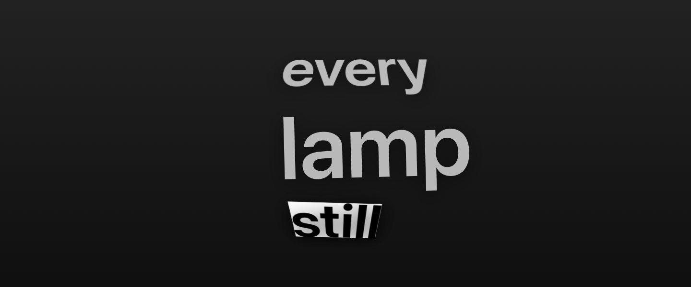

*Three stacked words, swollen in the middle like a glass lens.*

**How it plays.** Only the last three words of the line are on screen, centred. With three showing, the middle word
is the biggest, the "centre of the lens", and the words above and below are smaller and tipped back 38° as if seen
round the curve of a glass. The newest word, at the bottom, sits in a tight block of the highlight colour; the others
are in the secondary colour. Each new word springs in and pushes the others up.

**How it's built.** `WordStackStyle(kind: .fisheye(icons: false))`. Row sizes depend on how many rows are showing
(1; 1 and 0.85; 0.68, 1 and 0.68). The highlight block hugs the actual ink of the glyphs, measured with
`boundingRect(... .usesDeviceMetrics)`, rather than the line box. The lens is a `rotation3DEffect` around the
horizontal axis with perspective.

**Why it's designed this way.** Three words is about what the eye takes in at a glance, and the swollen middle draws
it to one place. A true lens would bend each glyph; that needs a Metal shader, which this command-line build cannot
compile, so the code notes the 3D tip as a deliberate shortcut to upgrade later. Tipping the outer rows gives the
same sense of curvature at no cost.

**Design theory.** *Focal point and span of attention:* three words is about what can be read in one fixation, and
the swollen middle gives the stack one obvious centre. *Figure and ground by colour:* only the newest word gets the
solid highlight block; the others drop to the secondary colour, so "now" and "just now" never compete. *Implied
form:* tipping the outer rows back 38° suggests a curved lens through perspective alone, the way a drawing suggests a
sphere with shading. The spring push-up keeps continuity: you see the old words make room rather than vanish.

**Notes.**
- Uses your font, the highlight colour and the secondary colour.
- Footprint 0.98. No sway.
- Does not respond to Reduce Motion.

## Visual

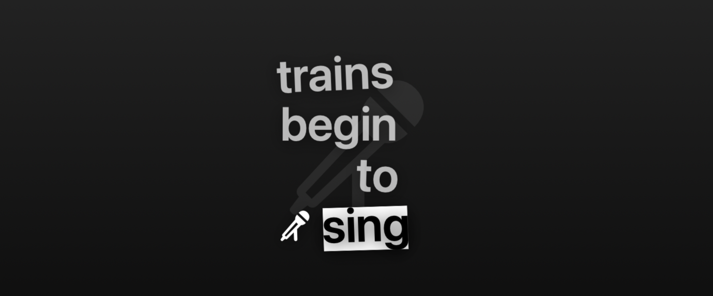

*A centred column of words, with a small picture where one fits.*

**How it plays.** Up to four words stack in a centred column, newest at the bottom in a highlight block, older ones
in the secondary colour. A word that has a picture gets it on one side (an SF Symbol in the highlight colour that
wiggles as it lands, or an emoji that swings in). Behind the column, the newest word's picture also appears huge and
faint, about half the band tall at 8% opacity, and cross-fades each time a new word arrives. The block sways gently,
half as much as Ship.

**How it's built.** `WordStackStyle(kind: .visual)` with `WordIcon` (`OverlayView.swift`) and `WordVisuals` (see
[Word pictures](#word-pictures)). The backdrop is drawn only for this style and is keyed on the number of words shown,
so SwiftUI's opacity transition does the cross-fade.

**Why it's designed this way.** The picture gives a word a second way in, at a glance, without crowding the text.
Putting the big picture behind the words at low opacity sets a mood for the line while the words stay in front and
fully legible.

**Design theory.** *Dual coding:* a word read alongside a picture is understood twice, through language and through
image, so the picture is placed beside the word, never in place of it. *Layered depth:* the large backdrop picture
at 8% opacity sits far behind the text in both size and contrast, so it colours the mood of the line without ever
becoming the figure. Its cross-fade, rather than a cut, keeps the background calm while the foreground changes word
by word. The sway is half of Ship's, because pictures already add movement.

**Notes.**
- Uses your font, the highlight colour (word block and symbols) and the secondary colour; the backdrop symbol is in
  the text colour.
- Footprint 0.99. Sway 0.5.
- Does not respond to Reduce Motion.

## Fisheye Visual

*The lens stack, plus pictures next to the words that earn one.*

**How it plays.** Exactly Fisheye, with a small picture beside each word that has one. There is no large backdrop
picture; that belongs to Visual.

**How it's built.** `WordStackStyle(kind: .fisheye(icons: true))`, sharing every line of Fisheye's layout and
adding `WordIcon` to each row.

**Why it's designed this way.** It is offered as its own style, rather than a switch on Fisheye, so that every look
is one click in the gallery and in the menu, with nothing extra to set.

**Design theory.** *Recognition over configuration:* a combination is offered as its own style rather than an
option, so it can be found by looking, in the window and in the menu, instead of by knowing a setting exists. The
pictures follow Visual's rule (beside the word, never instead of it), and the lens keeps Fisheye's single focal
point, so adding pictures does not add a second place to look.

**Notes.** As Fisheye. Footprint 0.98.

## Stretch

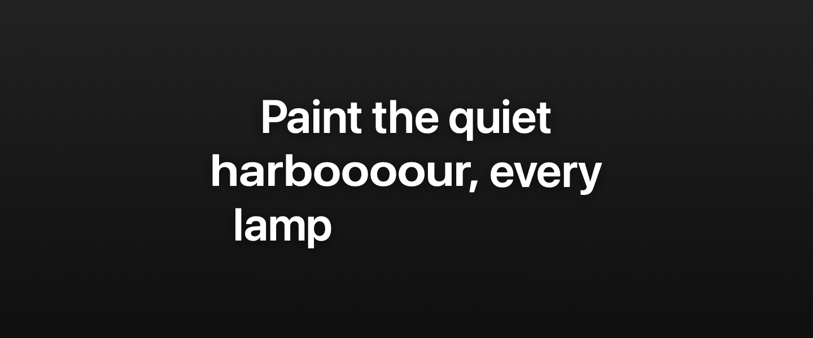

*Quick words snap in; held notes stretch wide, letter by letter.*

**How it plays.** The whole line is laid out, centred, in up to three rows, and each word appears in its place as it
is sung: a quick fade, a pop with a little overshoot, and a small rise. A word that is held stretches like the note:
its held vowel repeats ("harboooour"), one extra letter every 0.2 s up to six, each sliding out from under the one
before, while the word widens by up to 12% and squashes slightly. The held letters warm from the text colour toward
the highlight colour. When the note ends, the word relaxes back with a small recoil. The line fades out over 0.3 s as
its linger ends.

**How it's built.** `StretchStyle` and `StretchScene` in `Sources/StretchStyle.swift`, drawn in a single SwiftUI
`Canvas` from resolved `Text` pieces. `heldLetter` picks the vowel to hold, skipping a silent final "e". `hold(of:)`
decides which words stretch: with word-level timing, any word held 0.6 s, or 0.38 s if that is 1.4 times the line's
average; with estimated timing only the line's last word. Rows are balanced across the line, and each reserves room
for its widest stretch, so nothing reflows while the line is sung. If a line does not fit, the font steps down by
10% until it does.

**Why it's designed this way.** Singers stretch vowels, and this is the one style that shows it. Reserving the
stretched width up front keeps the rest of the line still while one word grows, so the eye is never chasing moving
words. Lines with estimated timing have no real holds to show, so only the end of the line is allowed to stretch.

**Design theory.** *Expressive typography:* the shape of a word follows the sound of it, as in comics and
concrete poetry, so a held vowel is literally longer. *Stability of layout:* each row reserves the width of its widest
stretch before the line plays, so only one word ever moves; the rest of the line is a fixed frame for it (the
Gestalt idea of a stable ground making one change obvious). *Motion that carries meaning:* the pop, rise and recoil
are flourishes and go with Reduce Motion; the stretch itself stays, because it *is* the information. The warm shift
toward the highlight colour marks the held part as the important part.

**Notes.**
- Uses your font, the text colour and the highlight colour. A soft dark shadow under the text.
- Footprint 1.2.
- Reduce Motion removes the pop, the rise and the recoil; the stretch itself stays, since it carries meaning.

## Ransom Note

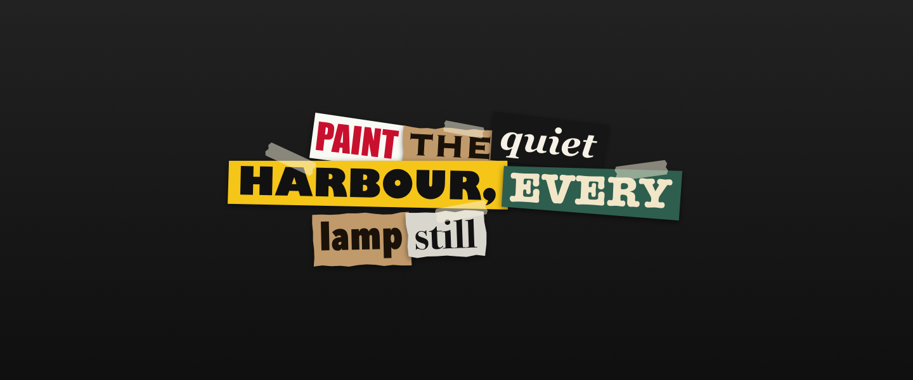

*Every word is a scrap cut from a different magazine and taped down.*

**How it plays.** Each word is cut from a different "magazine": its own typeface, its own paper and ink. As it is
sung, the scrap slaps down onto the page: it falls from half again its size with a spin, lands with a little squash
and wobble, and its shadow tightens as it touches down. Scraps lean up to 7.5°, sit slightly above or below the line
and overlap their neighbours; about a third carry a strip of torn tape. The line wraps into up to three balanced
rows, and fades out when its linger ends (but not before the last scrap has landed).

**How it's built.** `RansomNoteStyle` in `Sources/RansomNoteStyle.swift`, one `Canvas` drawn a little taller than
the band so scraps can fall in from above. `Pasteup` lays each line out once and caches it. `cut()` picks one of 14
faces (New York, Didot, Futura Condensed, Impact, Copperplate, SF Rounded and others) and one of 10 paper-and-ink
pairs, never repeating either from the neighbouring scrap, and sizes every face to the same cap height. The letters
are real CoreText glyph outlines filled as paths, so every face and fallback font draws correctly; a word with no
outlines, such as an emoji, falls back to text. `paper()` makes a torn or scissor-cut edge, and `tape()` the
zigzag strip. Rows come from a small dynamic programme that minimises the widest row.

**Why it's designed this way.** The collage only works if neighbouring scraps contrast, so the style ignores your
font and colours on purpose and brings its own high-contrast pairs, which also keeps every word readable over any
wallpaper. Matching cap heights stops a condensed face from looking smaller than a wide one. Everything is seeded
from the word's start time and place in the line, so a scrap never changes face mid-song.

**Design theory.** *Contrast between neighbours:* a collage only reads as a collage if each scrap differs from
the one beside it, so typeface and paper are never repeated next to each other. *Optical sizing:* matching cap
heights rather than point sizes makes every face look the same size, which is how the eye judges it. *Physicality
for timing:* each scrap falls, squashes and settles, a small piece of animation physics (squash and stretch) that
makes the moment a word is sung feel like a thing landing. *Readability by construction:* paper and ink come in
fixed high-contrast pairs, so the style never depends on the wallpaper.

**Notes.**
- Ignores your font and all three colours; Size still applies.
- Footprint 0.85.
- With Reduce Motion each scrap simply fades in.

## Ink

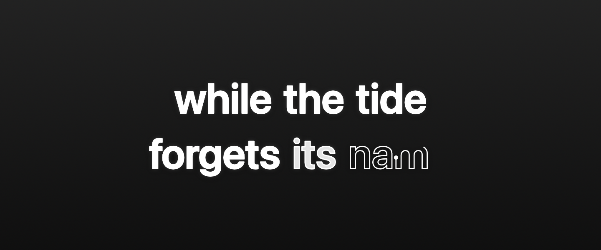

*Each word writes itself with a pen stroke, then the ink soaks in.*

**How it plays.** As each word is sung, a pen traces the outline of every letter, in your font,
over the time the word is sung (between 0.22 s and 1.8 s), slowing slightly at the end. A small nib in the
highlight colour rides the tip of the stroke. From 80% of the way through, the fill soaks in over half a second with
a soft bleed at the edges, then dries from the highlight colour to the text colour over 1.2 s. Earlier words stay
written. When a new line begins before the old one has left, the old line stays whole for a moment and fades over
the new line's first 0.35 s.

**How it's built.** `InkStyle` and `InkPage` in `Sources/InkStyle.swift`, in one `Canvas`. `Outline.of` builds
each word's glyph outlines with CoreText at 100 pt (cached, 512 words) and normalises them: variable fonts draw a
glyph as overlapping contours, and the pen should trace only the visible edge. Writing progress is
`Path.trimmedPath(from:to:)`. The bleed is a blurred layer. Emoji, which have no outline, fade in instead.

**Why it's designed this way.** Writing a word over the time it is sung makes the timing visible in a way a fade
cannot: a long note is a slow hand. Thin, wet strokes would vanish over a bright wallpaper, so a dark halo is applied
once to the finished layer, not to each shape, which would darken the fills where they overlap.

**Design theory.** *Duration made visible:* the pen takes as long to write a word as the singer takes to sing it,
so timing becomes speed of hand, a mapping anyone reads without being told. The slight slowing at the end of each
stroke mimics a real hand easing off. *Progressive reveal:* outline first, then fill, then the colour drying from
highlight to text colour, three stages that say "being written", "written" and "settled". *Figure and ground:* one
dark halo over the finished layer keeps thin, wet strokes readable on bright wallpapers without darkening the places
where letters overlap.

**Notes.**
- Uses your font, the text colour and the highlight colour.
- Footprint 1.14.
- Reduce Motion hides the nib; the writing itself still plays.

## Liquid

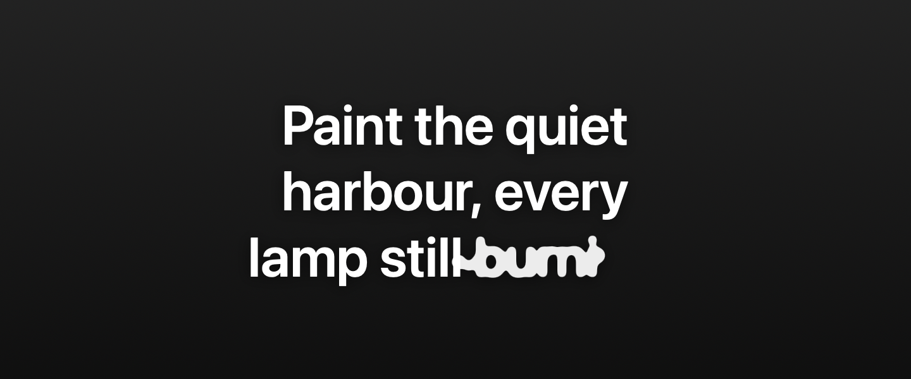

*Words ooze out of one another and the line melts away at its end.*

**How it plays.** Each word flows out of the end of the one before it: a sagging thread of beads runs across, and a
bulging front spreads along the new word, leaving soft, blobby letters in the highlight colour. Within 0.2 s the goo
firms up into crisp text in the text colour. A word that starts a row swells up in place from its middle instead.
At the end of the line it melts: words sag and droop, swell and thin, and drop one or two drips whose necks snap,
draining away just before the line's linger ends.

**How it's built.** `LiquidStyle` in `Sources/LiquidStyle.swift` uses the metaball technique in a `Canvas`: shapes
are drawn into a layer with a blur and then an alpha threshold (`.alphaThreshold(min: 0.5)`), so anything that
touches merges into one smooth blob. The text is drawn five times with tiny offsets so its thin strokes survive the
threshold. `flow`, `thread`, `sag` and `disc` build the shapes; drips are seeded.

**Why it's designed this way.** Blur-and-threshold gives real surface tension for the price of two filters, with no
physics. Blur costs by area, so the canvas covers only the text block and the room its drips need, not the whole
band. The goo is a moment of transition; the words always settle to crisp, shadowed text so they stay readable.

**Design theory.** *Continuity:* each word flows out of the end of the last, so the line reads as one connected
utterance, as it is sung. *Material honesty of a sort:* blur-and-threshold gives real surface tension, so the goo
behaves like a liquid without simulating one. *Transition, then rest:* the goo is a moment; within 0.2 s every word
settles into crisp, shadowed text, so the effect never costs readability. The melt at the end is a clear closing
gesture: the line is over, and you can see it go.

**Notes.**
- Uses your font, the text colour and the highlight colour.
- Footprint 1.1.
- Reduce Motion drops the threads, swells and melt; letters are revealed by the spreading edge and fade at the end.

---

## Motion scenes

Small animated scenes that carry the words: code, plants, webs, star charts, a station board, a staff, a marker,
a till.

## Codestyle

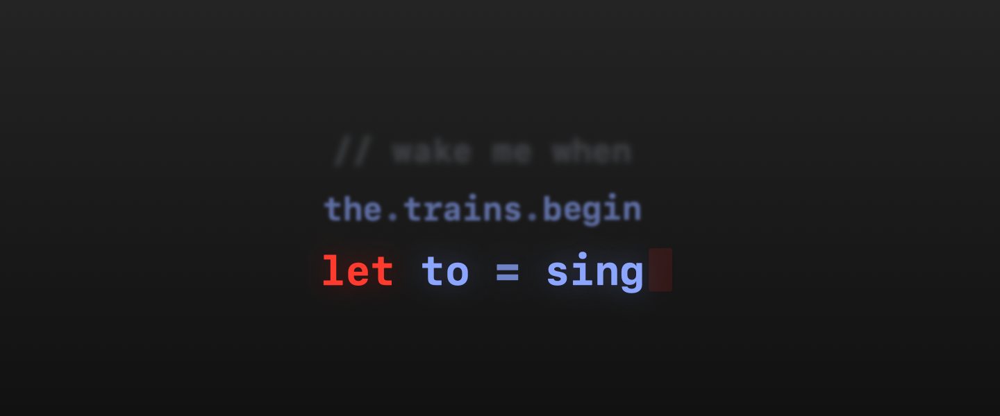

*Lyrics typed out like source code behind a blinking red cursor.*

**How it plays.** The line becomes make-believe code, up to three words to a row. Each letter types in as it is sung,
landing with a small bounce and glow, and a red block cursor follows the last letter typed; it stays solid while
typing and blinks when idle. Up to two earlier rows sit above, smaller, blurred and fainter. A new line flies in from
below with a tilt and a blur, each new row gives the block a small punch, and the whole block drifts and rocks
slowly. About one line in five gets a `// ran in 1.23s` comment after it ends.

**How it's built.** `CodeStyle` in `Sources/CodeStyle.swift`. `CodeScript.rows` splits the line into balanced rows
and gives each a seeded shape: a comment (`// a b c`), a call (`a.b(c)`), a binding (`let a = b.c`) or a chain
(`a.b.c`), sometimes ending in `;`. Words are coloured by role: "I", "I'm" and the like as red keywords, "you",
"she", "he" as orange, others as blue identifiers. The typing is a SwiftUI `TextRenderer` (`TypingRenderer`) that
reveals glyphs, not characters, evenly across each word's sung time, tagging each glyph with its word.

**Why it's designed this way.** Code is a familiar rhythm of short tokens, and a cursor is the most natural
"you are here" marker there is. The blur on the fly-in stands in for a directional motion blur, which needs a Metal
shader this build cannot compile. Row shapes and colours are seeded, so a line types out the same way every time.

**Design theory.** *Familiar metaphor:* a blinking cursor is the most widely understood "you are here" sign
there is, and typing is a rhythm of short tokens, like sung syllables. *Hierarchy by blur and size:* earlier rows are
smaller, fainter and blurred, so depth of field puts the current row in focus. *Colour as meaning:* the syntax
palette gives "I" and "you" roles of their own, so the people in a song stand out the way keywords do in code.
*Motion as punctuation:* the fly-in and the small punch on each new row mark line breaks the way an editor's scroll
does.

**Notes.**
- Ignores your font and colours: bold monospaced system type and its own syntax palette, with a dark shadow.
- Footprint 0.96.
- Does not respond to Reduce Motion.

## Codestyle Visual

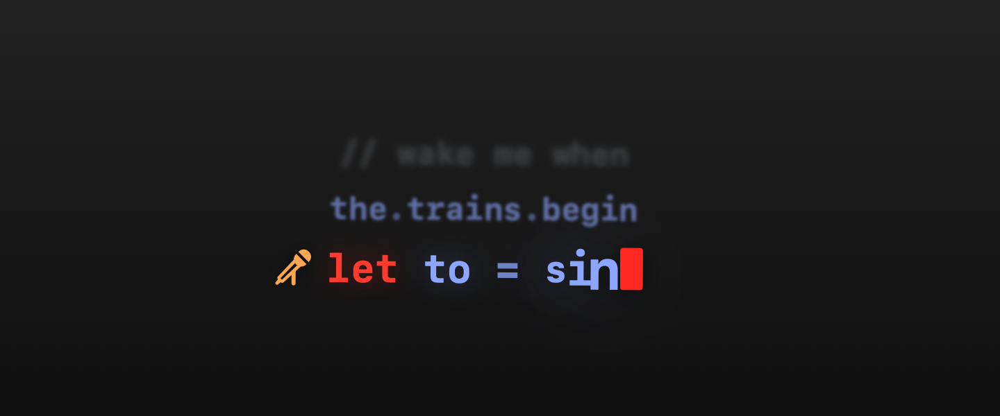

*The code look, plus pictures next to the words that earn one.*

**How it plays.** Codestyle, plus one picture for the current row: the picture of the most recent word in that row
that has one, hanging just outside the row's start or end (the side is seeded per row), past the cursor.

**How it's built.** `CodeStyle(context:, icons: true)` with [word pictures](#word-pictures). The icon is an overlay
on a zero-size anchor rather than part of the row's layout, so the row never jumps sideways when a picture turns up
mid-typing. Symbols take the palette's orange.

**Why it's designed this way.** One picture per row, outside the text, adds a hint of meaning without breaking the
code's shape.

**Design theory.** *Don't break the shape:* the picture hangs outside the row on a zero-size anchor, so the
code's alignment, the thing that makes it look like code, is never disturbed. One picture per row is a hint, not a
second reading path.

**Notes.** As Codestyle. Icons are 0.9 times the font size. Footprint 0.96.

## Branches

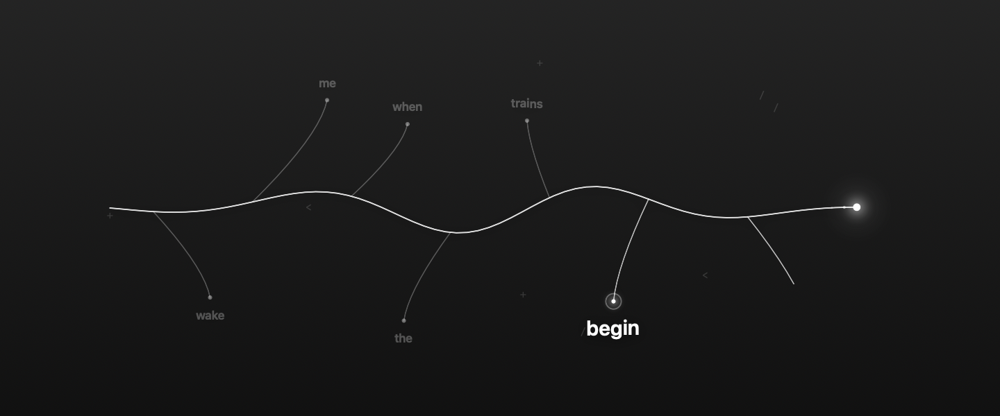

*A path grows across the screen and every word switches on a node.*

**How it plays.** A wavy stem grows across the band during the line, led by a glowing, pulsing head with a short
trail. Each word sprouts a springy branch above or below the stem, ending in a dot, the word and its picture if it
has one. While a word is sung its label is larger, its dot glows in the highlight colour and a ring pulses out;
long-held words are bigger still. Shortly after, the word calms: it shrinks, dims and shifts toward the secondary
colour. When the line ends, the stem erases from its start toward the head over the 0.8 s linger and the leaves
fade, with a last ring from the head.

**How it's built.** `BranchesStyle` in `Sources/BranchesStyle.swift`. One `Canvas` draws the stem, branches, dots,
head and a few faint background glyphs; the labels are SwiftUI text placed on top. The stem is a polyline from a
seeded swell plus two clock-driven ripples. `Planner.twigs()` plans every word's branch up front against the stem
without ripples, trying 12 seeded shapes on each side and scoring each by how much it would overlap other labels.
Branches are quadratic curves trimmed by growth, with a spring on the tip.

**Why it's designed this way.** Planning every branch before the line plays means labels never jump or reflow as
later words arrive. The scene is laid out narrower and then scaled, so a large Size cannot push the ends of the stem
off screen. A settled leaf has no glow, because a blur pass per leaf per frame is not free.

**Design theory.** *Continuity and growth:* the stem grows as the line is sung, a direct visual metaphor for a line
of song moving forward. *Stable layout:* every branch is planned before the line plays, so nothing jumps when later
words arrive; motion is reserved for things that are new. *Emphasis, then calm:* a word is large and glowing while it
is sung and settles smaller and dimmer afterwards, so there is only ever one bright thing. The erase at the end runs
from the start toward the head, the same direction as reading, so the line leaves the way it came.

**Notes.**
- Uses your font and all three colours.
- Footprint 0.92, height only: the stem spans the screen by design.
- Does not respond to Reduce Motion.

## Web

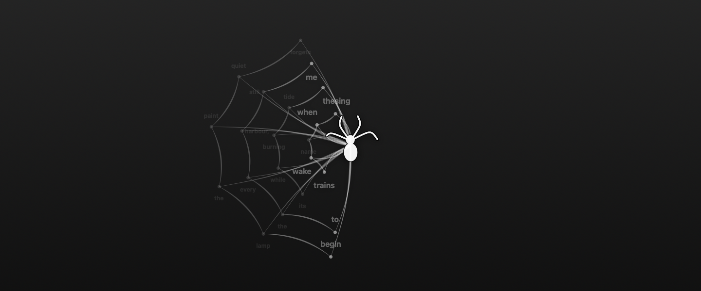

*A spider web that fills with words, one thread per word.*

**How it plays.** The song is cut into pages of 48 words, and each page is one web of 12 spokes and 4 rings. When a
word is sung, a tapered thread of silk shoots from the hub to the next free node, filling the web from left to right,
and ties on with sagging arcs to the neighbouring nodes that already hold words. The word appears with a twang that
pops the dot and tilts the label. The current word is large with a glowing dot; earlier words of the line, and words
of earlier lines on the page, fade by steps. A spider draws itself at the hub as the page fills, finishing its last
leg as the 48th word lands.

**How it's built.** `WebStyle` in `Sources/WebStyle.swift`, one `Canvas`. `WebGeometry` seeds each page's rotation
and spoke jitter from its first word. `WebSilk.ribbon` builds the silk as filled, tapered strips. `WebLabels.spots`
places labels greedily in sung order, avoiding the spider, earlier labels and the band's edge, so a label never moves
once it is placed. Word size is judged against the whole page, so a word never changes size later. The style has its
own assert-based checks in the self-check.

**Why it's designed this way.** A web is a natural place for words to collect: the history of the last few lines
stays visible and is clearly older (fainter), while the newest thread draws the eye. The spider is a progress bar in
disguise.

**Design theory.** *History made visible:* the last few lines stay on the web, faded by steps, so you can glance
back without losing your place; age is shown by contrast. *Progress in disguise:* the spider draws itself as the page
fills, a progress bar that belongs to the picture. *Stable placement:* labels are placed once, in sung order, and
never move; word size is judged against the whole page so nothing changes size later. The twang on arrival gives each
thread a physical moment of tension and release.

**Notes.**
- Uses your font and all three colours; the spider is in the text colour.
- Footprint 0.87.
- Does not respond to Reduce Motion. Gone in a gap longer than the linger.

## Constellation

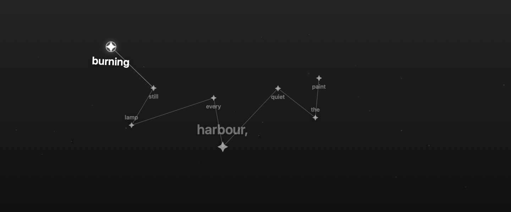

*A star pattern that grows one star per word.*

**How it plays.** The song is cut into chunks of 14 words, and each chunk becomes a constellation. Each sung word
lights a four-point star, joined to the previous one by a line that grows while the word is sung. The active star is
larger, in the highlight colour, with a glow and a rippling ring; resting stars dim to the text colour. Long words
arrive as a shooting star from the upper left and stay larger. Stars twinkle, faint dust shimmers in the background,
and a finished figure swells once after its last word.

**How it's built.** `ConstellationStyle` in `Sources/ConstellationStyle.swift`. `ConstellationMap` is a pure, seeded
layout: a `Walker` takes a random walk with golden-angle turns (12 tries per star), falling back to the roomiest cell
of a 14 by 7 grid, and allows a few short extra edges to close loops. It is small enough to rebuild every frame
without a cache. Lines are drawn first and labels last, so a later line never crosses an earlier word.

**Why it's designed this way.** Fourteen stars make a figure the eye can hold, and joining them in sung order turns
the line's rhythm into a shape. Whether a word counts as "long" is judged against the whole chunk, so a star never
changes class part-way through.

**Design theory.** *Closure:* the eye completes a shape from a few joined points, which is why constellations
work at all; fourteen stars is enough to make a figure and few enough to hold. *Rhythm as shape:* joining stars in
sung order turns the timing of the line into the geometry of the figure. *Stable classes:* whether a word is "long"
is decided against the whole chunk, so a star never changes size mid-figure. The twinkle and dust are low-contrast
background motion, kept well below the active star.

**Notes.**
- Uses your font and all three colours.
- Footprint 0.89, height only: it spans the screen by design.
- Does not respond to Reduce Motion. Gone in a gap longer than the linger.

## Departure Board

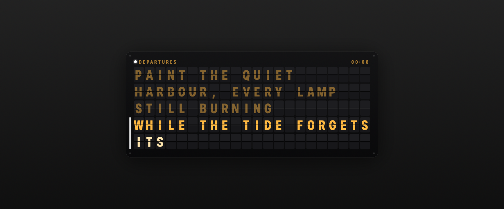

*A split-flap board clatters through letters until each word lands.*

**How it plays.** A dark split-flap board, 22 columns by 5 rows, under a "DEPARTURES" header with a clock. The line
being sung fills up to three rows at the bottom, scrolling a row at a time for long lines, and up to two earlier
lines sit above in dim amber. As each word starts, its tiles ripple from left to right, each spinning through a few
random letters before it settles. The word being sung glows brighter than the rest, a lamp in the highlight colour
lights while singing, and a marker in the highlight colour points at the current rows. Between lines the board stays
up and dims, then brightens just before the next line.

**How it's built.** `DepartureBoardStyle` in `Sources/DepartureBoardStyle.swift`, one `Canvas`. The flips are
stateless: for every word that started in the last 0.3 s, the style computes the board just before and just after
that word, and every cell that differs becomes a `FlapFlip` with its own delay (left to right, plus a little seeded
jitter) and spin count. `drawFlip` folds the old top half down onto the hinge and unfolds the new bottom half, with
shading. Resting tiles of the same shade share one path, so the whole board costs a handful of fills. Words in
joined scripts (Bengali, Hindi, Urdu, Arabic and others) are kept whole: the word sits in its first tile, the tiles
it covers are left blank, and it appears without spinning, since such letters fall apart drawn one at a time.

**Why it's designed this way.** Diffing two board states turns "which tiles flip, and when" into a pure function of
the position, so a flip looks identical in the overlay, the preview and a render. The board brings its own colours
so it reads the same over any wallpaper; only the lamp and marker follow you.

**Design theory.** *Skeuomorphism with a purpose:* a split-flap board is a machine everyone already reads
as "this has just changed", so a new word is announced by the clatter of the tiles. *Staggered timing:* tiles ripple
from left to right with a little seeded jitter, which reads as one mechanical sweep rather than a block switching at
once. *Stepping back in silence:* between lines the board stays up and dims (to 55%, after 5 s of quiet, since
0.4.2) and is fully lit again 2 s before the next line, so it behaves like a real board waiting for the next
departure. *Readability by construction:* the board brings its own dark surface and amber letters; only the lamp and
marker take your colour.

**Notes.**
- Ignores your font and the text and secondary colours; uses the highlight colour for the lamp and marker. Bold
  condensed system type, upper case.
- Stays on screen through pauses and dims (since 0.4.2).
- Footprint 1. Reduce Motion skips the flips.

## Score

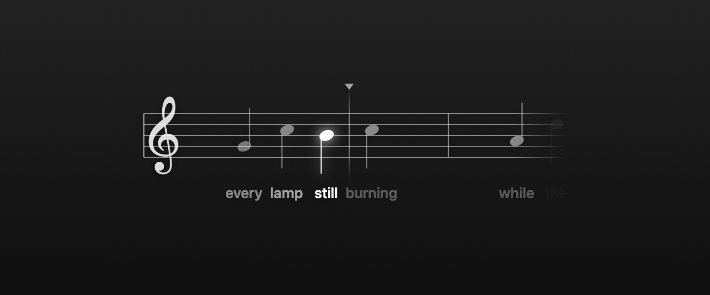

*Words fall under notes on a staff, each note as long as it is sung.*

**How it plays.** A five-line staff with a treble clef scrolls left past a fixed playhead. Each word sits under a
note placed at its start time, and the note's value follows how long the word is held: under 0.3 s an eighth note,
under 0.62 s a quarter, under 1.5 s a half, longer a whole note. As a note reaches the playhead it turns the highlight
colour with a glow and a small pop, and its word comes to full strength; words ahead and behind are faint. The staff
fades in after a silence and out before one.

**How it's built.** `ScoreStyle` in `Sources/ScoreStyle.swift`, one `Canvas`. Spacing between two notes depends only
on those two words (time at 9 staff spaces per second, capped, or the room their labels need), so the score scrolls
without anything reflowing. `Melody.pitch` gives each line a seeded arch and wave, kept within the staff so no
ledger lines are needed. Each note is one path (head, stem and flag), and the clef is the treble clef glyph's
outline from the Apple Symbols font.

**Why it's designed this way.** Mapping duration to note value makes the rhythm of the line visible: quick words are
flagged eighths, held words open whole notes. A fixed playhead with moving music is how scrolling scores and
rhythm games read, so the current word is always in the same place.

**Design theory.** *Rhythm as notation:* note values are a centuries-old code for duration, so eighths, quarters,
halves and whole notes show at a glance which words are quick and which are held. *A fixed reading point:* the music
moves past a fixed playhead, as in scrolling scores and rhythm games, so the current word is always in the same
place. *Spacing that never reflows:* the gap between two notes depends only on those two words. The staff fades in
after a silence and out before one, so a rest looks like a rest.

**Notes.**
- Uses your font for the words, the text colour and the highlight colour.
- Footprint 0.85, height only, trimmed so the staff still fits at 150%.
- Reduce Motion turns off the note pop.

## Highlighter

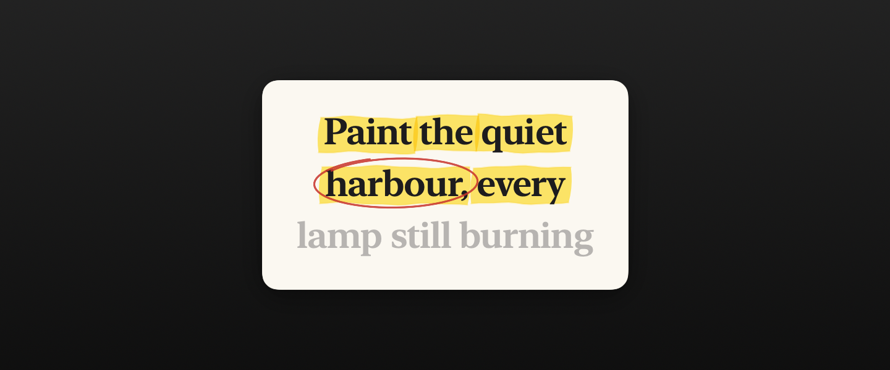

*The line sits printed on a card and a marker swipes each word.*

**How it plays.** The whole line appears printed in pale ink on an off-white card. As each word is sung, a felt
marker swipes across it from left to right over the word's sung time, and the ink under the swipe darkens. A word
that is held long gets a red pen circle drawn round it in step with the swipe. The card fades in and rises a little
after a silence, and fades out before one.

**How it's built.** `HighlighterStyle` in `Sources/HighlighterStyle.swift`. `balancedBreaks` wraps the line into
one to three rows with the narrowest widest row. The swipes are drawn in a `.multiply` layer so they tint the ink
like a real marker, with wobbling seeded edges, a slight tilt, a chisel offset and ink pooling along the edges. The
darkening is a clip at the marker's reach. The pen circle is 1.13 turns of a spiral, trimmed by the sweep. The
card's shadow is a SwiftUI shape outside the canvas, so it is not redrawn by hand every frame.

**Why it's designed this way.** It reads like studying a lyric sheet: you see the whole line ahead, and the marker
shows exactly where the singer is. A white highlight (the default) would vanish on paper, so the marker uses your
highlight colour only when it is saturated and dark enough to show, and classic yellow otherwise.

**Design theory.** *Preview, then mark:* the whole line is visible ahead, like a printed lyric sheet, and the
marker shows exactly where the singer is, so you can read ahead and still keep your place. *Familiar gesture:* the
swipe of a highlighter is a learned sign for "this part", and the multiply blend makes it tint the ink as a real
marker would. *Emphasis without new elements:* a long-held word gets a pen circle drawn in step with the swipe, a
second marking gesture rather than a new graphic. *Contrast check:* your highlight colour is used only when it would
show on paper; otherwise classic yellow.

**Notes.**
- Font: your font if it is New York or Didot, otherwise New York, because printed text wants a serif.
- Paper, ink and pen use fixed colours; the marker follows the highlight colour when it can.
- Footprint 1.05. Reduce Motion removes the rise and the ink fade-in.

## Receipt

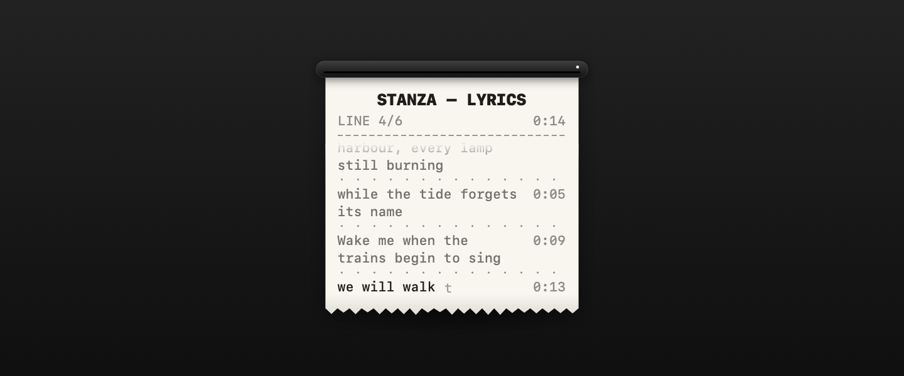

*A till prints the song, one line at a time, onto a curling receipt.*

**How it plays.** Thermal paper hangs from a till slot. The header stays at the top: "STANZA — LYRICS", the track
title, the line count and a clock. Each word's letters print over its sung time, each landing with a tiny wobble of
the print head and ink that darkens as it settles. The line's start time is printed at the right like a price, and a
finished line gets a row of dots. The paper feeds out as rows are added; once it is full length, older lines scroll
up under the header and fade into the paper. A lamp on the slot, in the highlight colour, brightens while it prints.
Between lines the receipt stays up and dims.

**How it's built.** `ReceiptStyle` in `Sources/ReceiptStyle.swift`, one `Canvas` on a 28-column monospaced grid
(22 for text, the rest for times). `tillWrap` places words on the grid; joined scripts are kept whole, as on the
Departure Board. The paper's length is counted from everything fed so far, so dropping old lines never shortens it.
`paperPath` makes the torn zigzag bottom; the curl is three layers of shading: a flattened shadow under the bottom
edge, a darkening just above the tear, and shade where the paper leaves the slot.

**Why it's designed this way.** A receipt is a record that grows, which suits a song: the history stays readable on
paper that brings its own contrast. Each frame is worked out from the position alone, so there is no view state.

**Design theory.** *A record that grows:* a receipt is a list that lengthens as it is printed, a natural
metaphor for a song unrolling. *Timing as typography:* letters print over each word's sung time, and the line's start
time is set where a price would be, so the receipt is also a timestamped transcript. *Stepping back in silence:* like
Departure Board, the receipt stays up and dims in long gaps. The curl and shading are skeuomorphic cues that make the
paper read as an object in front of the desktop, a surface with its own contrast.

**Notes.**
- Ignores your font and the text and secondary colours; medium monospaced system type; the highlight colour lights
  the lamp.
- Stays on screen through pauses and dims (since 0.4.2).
- Footprint 1. Reduce Motion feeds rows at once and drops the jitter and ink fade.

---

## Phone screens

Six styles imitate an app on a phone. Each lyric line becomes the thing that app shows: a message, a payment, an
alert, a turn, an event, a recording. They bring their own typeface (the system's) and colours, because the look of
the app is the point, and they draw the whole song so history can build up.

All six are planned once per song, where planning is needed, and then drawn as a pure function of the position in
one `Canvas` per frame. The plans are deterministic and seeded, so a song always plays out the same way.

## Messages

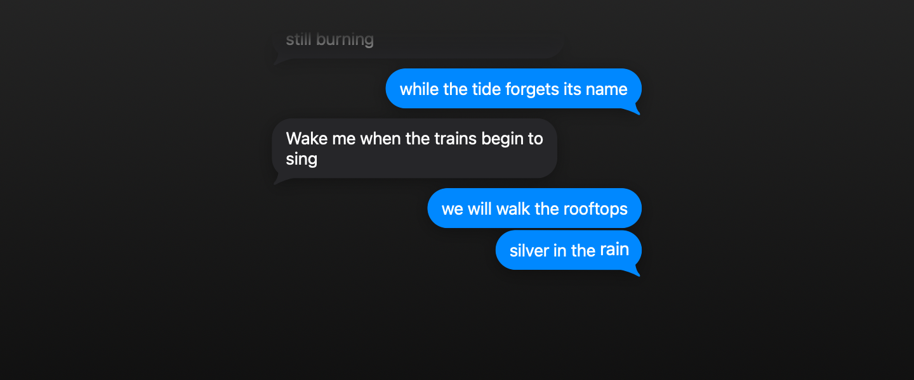

*The song arrives as a chat thread, one bubble per line.*

**How it plays.** Each lyric line is one chat bubble, grey on the left or blue on the right. Words appear one at a
time inside the bubble as they are sung, each popping up and sharpening, and a word held much longer than the rest
lands harder and sends a ring round the bubble. Before a line that follows a pause of a second or more, a typing
bubble with three bouncing dots appears, and the line's bubble grows out of it. A "Today" stamp with the time sits
above the first bubble and after any long gap. The newest outgoing bubble shows "Delivered", which turns to "Read"
once the other side starts typing. Older bubbles stack upward and leave through a soft fade at the top. In a long
silence the thread dims to 55% after 5 s and wakes 2 s before the next line.

**How it's built.** `MessagesStyle` in `Sources/MessagesStyle.swift`. `MessagesPlan` is computed once per song and
cached: which side each line is on (it changes after a pause of 0.7 s, after three lines in a row, or on a seeded
chance), typing leads, stamps, word wrap measured with AppKit, emphasis and tilt. Each frame, `MessageThread` works
out the scroll and every bubble's state from the position; motion uses a closed-form spring step response.

**Why it's designed this way.** A chat is the most familiar way to read short lines one after another, and a pause in
the music reads naturally as someone typing. The typing dots run on the wall clock, so they keep bouncing while the
music waits. The plan is compared against the whole lyrics, so corrected lyrics of the same shape still get a new
plan. A fast scroll gets a light blur in place of real motion blur, and blur is never applied at rest.

**Design theory.** *Familiar pattern:* a chat thread is the most practised way most people read short lines
in sequence, so nothing needs learning. *Meaning in silence:* a pause in the music becomes someone typing, and the
next line grows out of the typing bubble (spatial continuity). *Emphasis by force:* a word held much longer lands
harder and sends a ring round the bubble. *Calm in gaps:* the thread dims to 55% after 5 s of quiet and is awake 2 s
before the next line; the dots keep bouncing on the wall clock so the screen still feels alive while it waits.

**Notes.**
- System font and its own colours (white on grey or blue).
- Footprint 1.15. Its gap timings are the ones Departure Board and Receipt borrow.

## Money

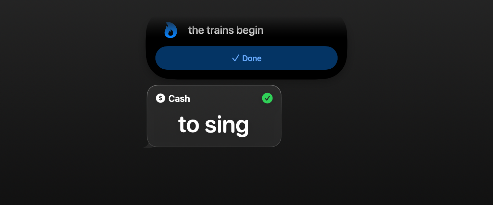

*Each line shows up as a payment, a card or a tap to pay.*

**How it plays.** Each line is cut into short chunks of up to three words (breaking early at a pause or a comma),
and each chunk arrives at the bottom of a feed as one of six items: a green cash bubble with a large amount-style
face, a black "island" platter with a progress bar and the song clock, a wallet card with colour blooms, a "Pay" sheet
naming the artist with a ring that fills to a tick, a map picture of a landmark with a pin, or a plain chat bubble.
After a pause, a small lead pill (typing dots, "Pay", or a bar meter) appears first and the item grows out of it. A
sung word with a symbol replaces the item's icon. The feed scrolls up, and dims in long silences like Messages.

**How it's built.** `MoneyStyle`, `MoneyFeed`, `MoneyPlan` and `MoneyMapPictures`. `MoneyPlan` is built once per
song: a new section after a long gap opens with a card, a chunk with a money word becomes a payment, otherwise a
seeded draw picks the kind, and the same kind never comes twice in a row (except the island). `MoneyFeed` is the
pure per-frame placement. The card blooms take their colours from the album cover when there is one.

The landmark pictures come from `MKMapSnapshotter` for a fixed list of 12 well-known places (the Eiffel Tower, the
Golden Gate Bridge and others), one request at a time, only for map items near the playhead, with a small cache. If a
picture is not ready, the item is drawn as its precomputed island twin, and a latch makes sure a row that came up as
one kind never turns into the other in front of you.

**Why it's designed this way.** Payment screens are full of big, bold short text, which suits a few words at a time.
Fixing each row's kind once it is shown keeps late network answers, pauses and seeks from changing what is already on
screen. Nothing but MapKit touches the network, and your location is never asked for.

**Design theory.** *Fit content to container:* payment screens are made of big, bold, short text, which suits a
few words at a time. *Variety without chaos:* six kinds of item, chosen once per song and never the same kind twice in
a row, give the feed rhythm without randomness on screen. *Object permanence:* once a row has appeared as one kind it
never turns into another, even if a map picture arrives late, so nothing changes in front of you. Items grow out of a
small lead pill after a pause, the same continuity rule as the window's panels.

**Notes.**
- System font, its own colours, plus album-cover colours on cards.
- Footprint 0.81.

## Notifications

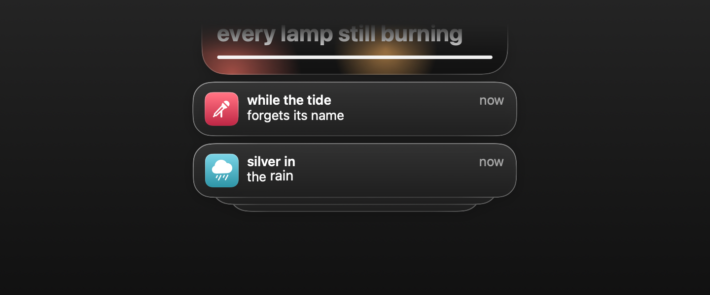

*Lines land as lock-screen alerts, piles and widgets.*

**How it plays.** Each line becomes one item on a lock screen: a notification banner (the first few words as a bold
title, the rest as the body, with "now" or "2m ago"), an assistant panel with a spinning rainbow rim that pulses with
each word, a "Now Playing" widget with the line in large type and a progress bar, or, in long silences, a "Now
Playing" glance row with a countdown ring to the next line. Banners that arrive in quick succession collapse into a
stack of up to three, older ones peeking out behind. Words rise, pop and sharpen one by one. The feed dims in a long
silence that has no glance row.

**How it's built.** `NotificationsStyle`, `NotificationsFeed` and `NotificationsPlan`. `NotifyPlanBuilder` decides
each line's kind once per song: a glance for a gap of 6 s or more, a widget when one is due after a long gap, a panel
for a line that reads like a question to an assistant (or on a seeded chance), and a banner otherwise, never two
panels or two widgets back to back. The plan is also keyed on the word-picture revision, so symbols that arrive late
trigger a rebuild. `NotifyPainter` paints everything into one canvas; the glass is faked with a dark fill, a sheen
and hairline rims.

**Why it's designed this way.** Notifications are what a lock screen already shows, so lyrics there feel native. The
glance row turns a long instrumental into something useful: how long until the next line.

**Design theory.** *Native context:* notifications are what a lock screen already shows, so lyrics in that form
feel at home exactly where Stanza draws them. *Grouping:* banners that arrive close together collapse into a stack,
the Gestalt principle of common region that the system itself uses. *Useful silence:* in a long instrumental the
glance row's countdown ring answers the only question there is, how long until the next line. The rainbow rim of the
assistant panel pulses with each word, so even a decorative surface keeps time.

**Notes.**
- System font, its own colours, plus album-cover colours in the widget.
- Footprint 1.08.

## Map

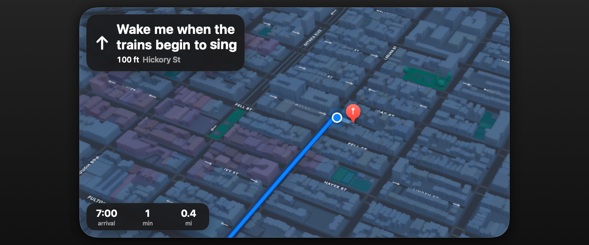

*A stroll through the city that drops a pin for each line.*

**How it plays.** The song is a walk across a built-in demo city, San Francisco. Each line is one leg of real walking
directions, longer for longer lines. A blue dot walks forward as each word is sung, and the camera follows smoothly.
A red pin drops at the end of each leg and sends out a ring when the line ends. The banner at the top left carries the
lyric, its words popping in, with a turn arrow, the distance to the next turn and the real street name; the card at
the bottom shows the arrival time and what is left of the walk. The trail you have walked stays on the map. Between
lines the next leg is announced and the dot waits at its start.

**How it's built.** `MapStyle` and `MapTour`. `MapPlan` is pure and seeded from the song itself, so a song keeps the
walk it always had; it chooses each leg's start, heading and turns, steering back toward the middle of the city.
`MapTour` fetches roads with `MKDirections` (walking) a few legs ahead, then map pictures with `MKMapSnapshotter` on
a 300 m grid, tilted when 3D is on. `MapLens` maps each flat picture onto the tilted ground with a homography, so the
picture can be drawn as a SwiftUI image with `projectionEffect`. Memory for pictures is capped (about 30 million
pixels), and the tour backs off when MapKit is slow or throttles.

**Why it's designed this way.** One leg per line makes progress through the song feel like distance, and the street
names give each line a place. The city and its routes are fixed, so nothing about you is used: your location is
never read.

**Design theory.** *Progress as distance:* one walked leg per line turns how far you are through the song into how
far you have walked, and the trail behind you is the song so far. *Place as memory:* real street names give each line
somewhere to be. *Smooth follow:* the camera eases after the walking dot rather than snapping, so the map never jolts
under the words. *Privacy by design:* the city and its routes are fixed, so the style needs nothing about you.

**Notes.**
- In the window, the Map has two extra buttons: **3D** or **Flat**, and **Window** or **Whole display**. Filling the
  display keeps the map at full size, scales only its text, fades the top and bottom to keep the lock-screen clock
  clear, and ignores Drag Position.
- System font, its own colours. Footprint 0.69 in a window.
- No dimming in pauses; fades out 5 s after the last word.

## Calendar

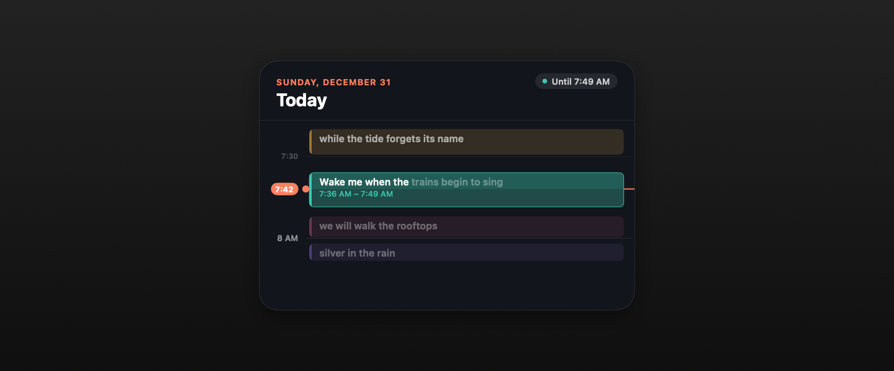

*The song becomes a day planner, one event for every line.*

**How it plays.** The song is one day in a planner, starting at 7 AM, with one second of music as four minutes of
the day. Each line is an event block at its start time, as tall as it is long. A coral "now" line with a time pill
walks down the day, and the view scrolls to keep it about a third of the way down. The event under way brightens,
grows if needed to fit its whole title, and its words fade from faint to full as they are sung. The header shows
today's date, the track title, and a chip: "Starts…", "Until…", "Free until…" or "Nothing else today". Past events
stay on the timeline.

**How it's built.** `CalendarStyle` in `Sources/CalendarStyle.swift`. `CalendarDay` and `CalendarEvent` are cheap
enough to recompute every frame, so there is no cache. Six event colours are chosen by `seededUnit`, never the same as
either of the two before. Overlapping lines in duets are indented, as calendars show clashing events.

**Why it's designed this way.** A planner shows the shape of the whole song at once: long lines are long blocks, gaps
are free time, and the chip tells you how long the gap lasts.

**Design theory.** *Overview first:* a day planner shows the shape of the whole song at once: long lines are
tall blocks and gaps are free time, an instant picture of the song's structure. *A moving "now":* the coral line
walks down the day and the view keeps it a third of the way down, so there is always context above and plenty to
come below. *Useful silence:* the header chip tells you how long the gap lasts ("Free until…"). Colours are seeded and
never repeat either of the two before, so neighbouring events always separate.

**Notes.**
- System font, its own colours. Footprint 1.
- No dimming in pauses (the chip says "Free until…"); fades out 4 s after the last line.

## Voice Memo

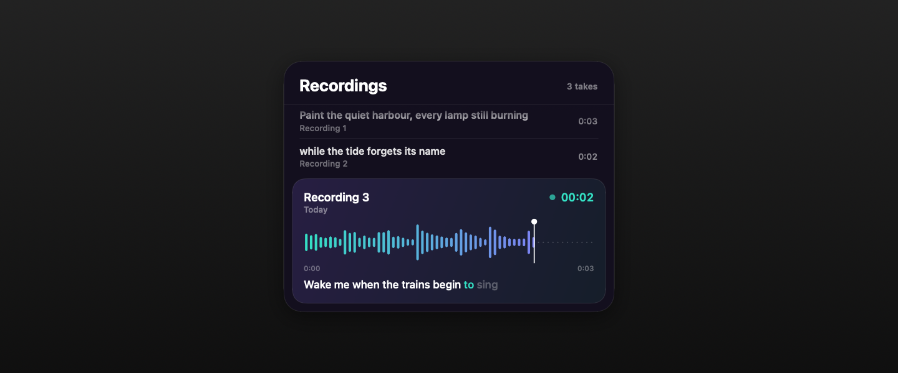

*Each line is a recording, its words lighting up under the waveform.*

**How it plays.** A "Recordings" list where each line is a take. The current take is the open panel at the bottom: a
pulsing dot and a timer while it records, a mirrored waveform drawing left to right behind a white playhead, and a
transcript underneath with the sung words in white, the current word in teal and the rest faint. When a new line
starts, the previous take shrinks into a row above with its text and length. Before the first line, the first take
waits, ready.

**How it's built.** `VoiceMemoStyle` in `Sources/VoiceMemoStyle.swift`. `MemoList` and `Take` are recomputed every
frame on a virtual card. The waveform does not come from the audio, which Stanza never hears: `Take.level` makes a
burst at each word's start that decays, sustains while the word lasts and is roughened per bar with `seededUnit`.

**Why it's designed this way.** A transcript under a waveform is a close cousin of karaoke, and the list of takes
keeps the song's history readable. Deriving the waveform from word timing means no microphone or audio access is
ever needed.

**Design theory.** *Transcript under a waveform* is the close cousin of karaoke, so the current word in teal is
read without explanation. *History as a list:* each finished line shrinks into a row above, so the song's past is a
tidy column. *Honest signal:* the waveform is drawn from word timing, a burst at each word that decays and sustains,
which looks like speech and needs no microphone; the picture never pretends to hear more than it does.

**Notes.**
- System font, its own colours. Footprint 1.
- No dimming in pauses; fades out 4 s after the last line.

---

## At a glance

| Style | Your font | Your colours | In a pause | Reduce Motion |
|---|---|---|---|---|
| Ship | yes | text, highlight | clears | no effect |
| Fisheye | yes | highlight, secondary | clears | no effect |
| Visual | yes | all three | clears | no effect |
| Fisheye Visual | yes | highlight, secondary | clears | no effect |
| Stretch | yes | text, highlight | fades, clears | calmer |
| Ransom Note | no | none | fades, clears | fades only |
| Ink | yes | text, highlight | fades, clears | no nib |
| Liquid | yes | text, highlight | melts, clears | no goo |
| Codestyle | no | none | clears | no effect |
| Codestyle Visual | no | none | clears | no effect |
| Branches | yes | all three | erases, clears | no effect |
| Web | yes | all three | clears | no effect |
| Constellation | yes | all three | clears | no effect |
| Departure Board | no | highlight | stays, dims | no flips |
| Score | yes | text, highlight | fades, clears | no pop |
| Highlighter | New York or Didot | highlight (marker) | fades, clears | calmer |
| Receipt | no | highlight (lamp) | stays, dims | calmer |
| Messages | no | none | stays, dims | calmer |
| Money | no | album cover | stays, dims | calmer |
| Notifications | no | album cover | stays, dims | calmer |
| Map | no | none | stays | calmer |
| Calendar | no | none | stays | calmer |
| Voice Memo | no | none | stays | calmer |

"Clears" means the style is gone 0.8 s after a line ends if the next line has not begun. "Calmer" means the style
turns off its decorative motion but keeps the movement that carries timing.
